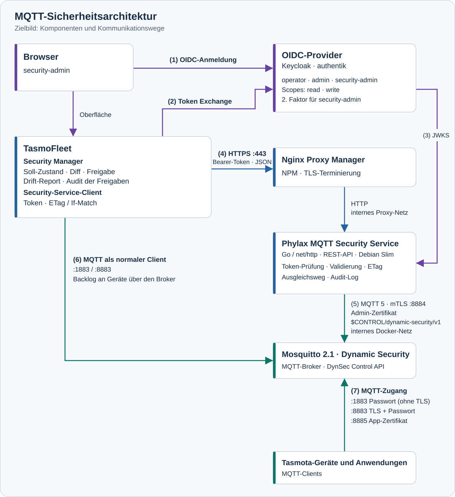

# Design: Phylax MQTT Security Service mit Mosquitto Dynamic Security

**Status:** Entwurf zur technischen Review\
**Version:** 1.1\
**Datum:** 25. November 2026\
**Zielumgebung:** Mosquitto in [IOTstack](https://github.com/SensorsIot/IOTstack) (Docker Compose)\
**Broker:** Eclipse Mosquitto ab 2.1, getestet mit 2.1.2, Integrationstests und Produktion mit 2.1.4\
**Identity Provider:** OIDC-Provider mit Token Exchange nach RFC 8693; getestet mit Keycloak 26.8.2 und authentik 2026.8.6, mindestens Keycloak 26.2 bzw. authentik 2026.8.3\
**Implementierungssprache:** Go\
**Projektname:** Phylax MQTT Security Service\
**GitHub-Repository:** [`Noschvie/phylax-mqtt-security-service`](https://github.com/Noschvie/phylax-mqtt-security-service)\
**Kurzbeschreibung:** A REST API service for managing Mosquitto Dynamic Security clients, roles and access control.\
**Lizenz:** GNU Affero General Public License v3 oder später, SPDX `AGPL-3.0-or-later` (Lizenztext wie [TasmoFleet](https://github.com/hellwand/tasmofleet/blob/main/LICENSE))\
**Schnittstellenspezifikation:** „MQTT Security Service API v1“ (`mqtt-security-service-api-v1`, aktuelle Fassung); PMSS ist die Referenz-Implementierung\
**Architektur-Überblick:** `mqtt-security-overview` (aktuelle Fassung)

> **Hinweis zur Benennung**
> Im Dokument steht „Security Service“ bzw. „Service“ kurz für den Phylax MQTT
> Security Service. Repository, Image, Binary und Compose-Service heißen
> `phylax-mqtt-security-service`.

> **Hinweis zur Schnittstellenspezifikation**
> Dieses Dokument wiederholt die Schnittstellenspezifikation nicht
> vollständig. Es verweist auf sie und beschreibt nur, **wie** PMSS sie
> umsetzt (DynSec-Kommandos, Validierung, Audit, Tests). Bei
> Abweichungen gilt die Spezifikation.

> **Hinweis zu Namen und Umgebung**
> Namen von Hosts, Benutzern und Domains sind Platzhalter:
> `legacy-shared-user` für den gemeinsamen Bestandsbenutzer,
> `mqtt.example.org` für den Broker-Namen der TLS-Listener, „Broker-Host“
> für den Rechner, auf dem IOTstack läuft. Die Angaben zu einer konkreten
> Installation stehen in einem getrennten Betriebsdokument.

> **Hinweis zu den Identity Providern**
> Keycloak und authentik werden getrennt behandelt: eigene Abschnitte
> zur Konfiguration (7.5) und eigene Tests (7.9). Wo nichts anderes
> steht, gilt eine Aussage für beide.

------------------------------------------------------------------------

## 1. Ziel und Zusammenfassung

Ziel ist die schrittweise Ablösung der bisherigen Mosquitto-Verwaltung
über `password_file` und optional `acl_file` durch das integrierte
**Mosquitto Dynamic Security Plugin (DynSec)**.

Die Benutzer- und Rechteverwaltung soll zunächst direkt mit
`mosquitto_ctrl` erfolgen. Als nächste Ausbaustufe ist ein
eigenständiger **Phylax MQTT Security Service** als **Go-Anwendung**
vorgesehen. Dieser stellt eine REST-API bereit und kommuniziert intern
über MQTT mit dem Broker.

Die Architektur trennt drei Aufgaben:

1.  **Externe Administration:** HTTPS-geschützte REST-API.
2.  **Interne Verwaltungskommunikation:** MQTT über TLS und mTLS in
    einem privaten Docker-Netzwerk.
3.  **MQTT-Zugriff der Geräte und Anwendungen:** Authentifizierung und
    Topic-Berechtigungen durch Dynamic Security.

Die erste Migration soll bewusst klein bleiben: Der gemeinsame
Bestandsbenutzer wird übernommen. Die Berechtigungen werden
zunächst kompatibel zum bisherigen Zustand gehalten und danach
schrittweise eingeschränkt.

## 2. Ausgangslage

### 2.1 Typische Installation

Ausgangspunkt ist Mosquitto als Docker-Container in IOTstack:

| Merkmal | Ausgangszustand |
|---|---|
| Mosquitto-Version | ab 2.1 (getestet mit 2.1.2) |
| Dynamic-Security-Bibliothek | `/usr/lib/mosquitto_dynamic_security.so`, im offiziellen Image enthalten |
| `mosquitto_ctrl` | mit DynSec-Modul |
| Compose-Projekt | `~/IOTstack` |
| Mosquitto-Konfiguration | `volumes/mosquitto/config/mosquitto.conf` |
| Persistente Daten | `volumes/mosquitto/data` |
| Passwortdatei | `volumes/mosquitto/pwfile/pwfile` |
| MQTT-Benutzer | ein gemeinsamer Bestandsbenutzer, hier `legacy-shared-user` |
| Listener | TCP 1883 |
| Anonyme Verbindungen | deaktiviert (`allow_anonymous false`) |
| ACL-Datei | optional, häufig nicht aktiv |

### 2.2 Authentifizierung und Berechtigungen vor der Migration

Typische Konfiguration in `mosquitto.conf`:

``` ini
listener 1883
password_file /mosquitto/pwfile/pwfile
allow_anonymous false
#acl_file /mosquitto/config/filter.acl
```

Ist keine ACL-Datei aktiviert, gibt es keine Topic-Einschränkung durch
eine Mosquitto-ACL-Datei. Authentifizierte Clients haben dann
grundsätzlich Zugriff auf alle Topics. Mit einem gemeinsamen Benutzer
hilft auch eine ACL-Datei nur eingeschränkt, weil sich Rechte pro Gerät
nur über die nicht authentifizierte Client-ID trennen lassen.

**Migrationshinweis:** Die Passwortdatei enthält Passwort-Hashes, nicht
das ursprüngliche Klartextpasswort. Mosquitto 2.1 speichert
DynSec-Passwörter im selben Format (sha512-pbkdf2, `$7$…`) als
`encoded_password`. Der Hash lässt sich deshalb übernehmen; das
bisherige Passwort bleibt gültig (getestet 20.11.2026 mit Mosquitto
2.1.2). Vor der Migration ist zu prüfen, ob die `pwfile` `$7$`-Hashes
enthält.

> **Entscheidung**
> Der vorhandene Passwort-Hash wird in DynSec übernommen (Abschnitt
> 6.2). Kein Gerät und keine Anwendung wird bei der ersten Migration
> angefasst; es gibt kein Migrationsfenster für Passwörter. Das
> gemeinsame Passwort wird später durch individuelle Zugangsdaten pro
> Gerät abgelöst.

## 3. Architektur-Zielbild

### 3.1 Komponenten

| Komponente | Aufgabe |
|---|---|
| Mosquitto Broker | MQTT-Broker und Ausführung des DynSec-Plugins |
| Dynamic Security Plugin | Clients, Gruppen, Rollen, ACLs und Passwortprüfung |
| `dynamic-security.json` | Persistenter DynSec-Zustand |
| Phylax MQTT Security Service | Go-Dienst für REST-API (`net/http`) und MQTT-Control-API (Eclipse Paho Go) |
| Nginx Proxy Manager (NPM) | Externer HTTPS-Einstiegspunkt und Reverse Proxy |
| OIDC-Provider (Keycloak oder authentik) | Stellt die Bearer-Tokens (JWT) für die REST-API aus; Scopes `read`/`write`; derselbe Provider, bei dem sich die Benutzer an TasmoFleet anmelden |
| Interne CAs | **Server-CA:** Server-Zertifikate von Mosquitto (intern und für die TLS-Listener). **Admin-CA:** ausschließlich Client-Zertifikate der DynSec-Admins. **App-CA:** ausschließlich Client-Zertifikate von Anwendungen mit „TLS erforderlich“. CA-Zertifikate separat und read-only eingebunden, CA-Schlüssel offline |

### 3.2 Kommunikationswege



*Abbildung 1: Architektur-Zielbild und Kommunikationswege.
Die Nummern kennzeichnen Verbindungen, keine feste zeitliche Reihenfolge; eine
Beschreibung der Wege steht in der [Schnittstellenspezifikation, Abschnitt 1.1](mqtt-security-service-api-v1.de.md#11-blockschaltbild).*

Bei (3) ruft PMSS die öffentlichen Schlüssel (JWKS) beim OIDC-Provider
ab; der Pfeil zeigt die Richtung der zurückgegebenen Schlüssel. Bei (4)
terminiert NPM HTTPS und leitet die Anfragen über HTTP im internen
Proxy-Netz an PMSS weiter. Verbindung (5) nutzt das private Docker-Netz
und ein Admin-Zertifikat mit `CN=pmss-admin`. Port 8885 in (7) ist
Anwendungen mit App-Zertifikat vorbehalten.

Die REST-API und die MQTT-Control-API sind zwei unterschiedliche Schnittstellen:

-   REST ist die Schnittstelle für Admin-UIs und andere Management-Anwendungen.
-   MQTT ist die interne Schnittstelle, über die der Security Service
    DynSec-Kommandos an Mosquitto sendet.

Der Security Service soll nicht direkt die Datei `dynamic-security.json`
bearbeiten. Änderungen erfolgen über die offizielle MQTT-Control-API des Plugins.

### 3.3 Technologieentscheidung Security Service

> **Entscheidung**
> Der Phylax MQTT Security Service wird in **Go** statt in Node.js
> implementiert. Es werden so weit wie möglich Pakete der
> Go-Standardbibliothek verwendet; zentrale Fremdabhängigkeiten sind
> der MQTT-Client und die JWT-Prüfung.

| Bereich | Entscheidung | Bemerkung |
|---|---|---|
| Programmiersprache | Go ✅ | Ersetzt Node.js ❌. Jeweils aktuelle Version, derzeit Go 1.27. |
| HTTP-API | `net/http` (Standardbibliothek) | Routing über `http.ServeMux` mit Methoden- und Pfadmustern (z. B. `GET /api/v1/clients/{username}`, Zugriff über `r.PathValue`). Kein zusätzliches Web-Framework. |
| MQTT | Eclipse Paho Go, MQTT 5, `autopaho` | `github.com/eclipse/paho.golang/autopaho` übernimmt Verbindungsaufbau und Reconnect. Das Response-Topic abonniert der Service selbst in `OnConnectionUp` (Abschnitt 7.2). Keine eigene Reconnect-Schicht über `paho`, kein Fallback auf MQTT 3.1.1. |
| JSON | `encoding/json` | Typisierte Structs für DynSec-Kommandos und -Antworten |
| JWT-Prüfung | `github.com/coreos/go-oidc/v3` (mit `go-jose/v4`) | `oidc.NewVerifier` mit festem Issuer und eigenem, gedrosseltem `KeySet` (JWKS aus `PMSS_OIDC_JWKS_URL`, sonst `jwks_uri` aus dem Discovery-Dokument), kein `oidc.NewProvider`; Signatur, `iss`, `aud`, `exp`/`nbf`, Algorithmus. `scope`, `typ` (je Provider) und Scopes prüft der Service (Abschnitt 7.5, T-7 bis T-9) |
| TLS/mTLS | `crypto/tls`, `crypto/x509` | Eigener `RootCAs`-Pool mit dem Zertifikat der Server-CA, Client-Zertifikat (Admin-CA) über `tls.LoadX509KeyPair`, `ServerName` = Broker-Servicename, `MinVersion` TLS 1.2 oder höher |
| Logging | `log/slog` | Strukturiertes Logging (JSON-Handler) für Betriebs- und Audit-Logs |
| Container-Runtime | Debian Slim ✅ | `debian:trixie-slim` (Debian 13) statt `scratch` ❌. Imagegröße ist kein Entscheidungskriterium. |
| Interne CAs | Separat, read-only eingebunden | CA-Zertifikat als eigener `:ro`-Mount; CA-Private-Keys nie im Container |

Begründung:

-   Statisch kompiliertes Binary ohne Laufzeit-Abhängigkeiten
    (Node.js-Runtime, `node_modules`) und mit kleiner, gut prüfbarer
    Abhängigkeitsliste (`go.mod`/`go.sum`).
-   HTTP-Server, JSON, TLS und strukturiertes Logging sind in der
    Standardbibliothek vorhanden und gut gepflegt.
-   Nebenläufige Request/Response-Korrelation lässt sich mit
    Goroutinen, Channels und `context.Context` (Timeouts, Abbruch)
    direkt abbilden.
-   Einfache Cross-Kompilierung für `amd64` und `arm64`
    (`CGO_ENABLED=0`, `GOOS`/`GOARCH`).

## 4. Netzwerk- und Portkonzept

### 4.1 Listener

Vorgeschlagene Listener:

| Port | Zweck | Erreichbarkeit | Verschlüsselung / Anmeldung |
|---|---|---|---|
| 1883 | Geräte und Anwendungen ohne TLS | IoT-Netz | Unverschlüsselt; Benutzername/Passwort |
| 8883 | Geräte und Anwendungen mit TLS, Anmeldung per Passwort | LAN; IoT-Netz, sobald Geräte dort TLS nutzen | TLS (Server-Zertifikat der Server-CA); Benutzername/Passwort |
| 8885 | Anwendungen mit „TLS erforderlich“ | LAN | TLS, nur Client-Zertifikat der App-CA, Benutzername = Zertifikats-Subject, kein Passwort |
| 8884 | Interner Admin-Zugang (Phylax MQTT Security Service, Break-glass) | Nur über das interne Docker-Netzwerk | TLS, nur Client-Zertifikat der Admin-CA, Benutzername = CN, kein Passwort |

> **Entscheidung**
> Der interne Listener verwendet Port **8884**. mTLS ist dort
> **verpflichtend**: Verbindungen ohne gültiges Client-Zertifikat werden
> abgewiesen.

> **Entscheidung**
> Am Listener 8884 werden nur Zertifikate der **Admin-CA** akzeptiert.
> Der Benutzername wird aus dem CN übernommen
> (`use_identity_as_username true`); ein Passwort gibt es nicht
> (Abschnitt 5.2). Der Listener wird **vor** der DynSec-Aktivierung
> eingerichtet (Abschnitt 9, Phase 1).

> **Entscheidung**
> Zusätzlich zu 1883 und 8884 gibt es zwei TLS-Listener: **8883** für
> Clients mit Passwort und **8885** für Anwendungen, die sich nur per
> Zertifikat der App-CA anmelden. Beide werden als eigene Phase nach
> dem Funktionstest eingeführt (Abschnitt 9, Phase 5). Untergrenze ist
> TLS 1.2 (`tls_version tlsv1.2`), weil Tasmota kein TLS 1.3 kann.
> Anwendungen werden gleich behandelt, egal ob sie als Container, in
> einer VM oder auf einem anderen Host laufen; es gibt keinen
> Sonderweg über das Docker-Netz.

Ein Listener kann Zertifikats- und Passwortanmeldung nicht mischen: Mit
`require_certificate false` und `use_identity_as_username true` lehnt
Mosquitto 2.1.2 beide Arten ab (getestet 20.11.2026). Deshalb gibt es
getrennte Listener für Passwort (8883) und Zertifikat (8885).

Port 8884 ist ein interner MQTT/TLS-Port. Die Portnummer selbst
aktiviert keine Verschlüsselung; diese wird durch die TLS-Konfiguration
des Listeners festgelegt.

Port 8884 wird **nicht** über `ports:` auf dem Docker-Host
veröffentlicht. Der Security Service erreicht den Broker über den
Docker-Service-Namen und Port 8884.

**Erreichbarkeit je Netz:** Die Beschränkung erfolgt über
Firewall-Regeln am Router. Sie ist nicht Teil dieses Projekts; das
Dokument legt nur fest, was erreichbar sein muss:

| Port | IoT-Netz | LAN | Bemerkung |
|---|---|---|---|
| 1883 | ✅ | ❌ | Klartext nur im IoT-Netz |
| 8883 | ✅ (sobald Geräte TLS nutzen) | ✅ | |
| 8885 | ❌ | ✅ | |
| 8884 | ❌ | ❌ | Nicht veröffentlicht, nur internes Docker-Netz |

### 4.2 Docker-Netzwerke

Der Broker und der Security Service teilen ein dediziertes internes
Netzwerk. Der Security Service ist zusätzlich mit dem Netzwerk
verbunden, über das NPM den REST-Dienst erreicht.

Konzeptionelles Beispiel – vor Umsetzung an das bestehende Compose-File
anpassen:

``` yaml
services:
  mosquitto:
    networks:
      - mqtt-internal
      - mqtt-existing

  phylax-mqtt-security-service:
    networks:
      - mqtt-internal
      - api-internal

networks:
  mqtt-internal:
    internal: true

  api-internal:
  mqtt-existing:
```

NPM muss den Security Service über ein gemeinsames Proxy-Netzwerk
erreichen können. Die konkrete Netzwerkanbindung ist anhand der
bestehenden NPM- und IOTstack-Compose-Konfiguration festzulegen.

Lädt der Security Service die Schlüssel des OIDC-Providers über das
interne Netz (Abschnitt 7.5, `PMSS_OIDC_JWKS_URL`), braucht er
zusätzlich ein gemeinsames Netz mit dem Provider. Das kann das
Proxy-Netz sein, über das NPM beide Dienste erreicht, oder ein eigenes
Netz nur für den Schlüsselabruf.

**Sicherheitsgrenze:** Ein internes Docker-Netzwerk verhindert die
normale Erreichbarkeit von außen und aus nicht verbundenen
Docker-Netzen. Es schützt jedoch nicht gegen einen kompromittierten
Docker-Host oder privilegierte Host-Administratoren. Die Netztrennung
ist die zweite Ebene: Der Broker selbst lehnt den Admin an
allen anderen Listenern ab (Abschnitt 5.2).

## 5. TLS- und Zertifikatskonzept

### 5.1 Interne CAs

> **Entscheidung**
> Für die Verbindung zwischen Security Service und Mosquitto werden
> **zwei** interne CAs verwendet: eine **Server-CA** und eine
> **Admin-CA**.

> **Entscheidung**
> Für Anwendungen mit „TLS erforderlich“ kommt eine dritte CA hinzu,
> die **App-CA**. Die Server-CA stellt zusätzlich das Server-Zertifikat
> für die TLS-Listener 8883 und 8885 aus. Let's Encrypt wird nicht
> verwendet.

| CA | Signiert | Wer vertraut ihr |
|---|---|---|
| Server-CA | Internes Server-Zertifikat (SAN `mosquitto`, Listener 8884) und externes Server-Zertifikat (SAN `mqtt.example.org`, Listener 8883 und 8885), jeweils `extendedKeyUsage=serverAuth` | Security Service (`RootCAs`), `mosquitto_ctrl` beim Break-glass, alle Clients der Listener 8883 und 8885 |
| Admin-CA | Ausschließlich Client-Zertifikate der DynSec-Admins `pmss-admin` und `pmss-breakglass-admin` (`extendedKeyUsage=clientAuth`) | Mosquitto, Listener 8884 (`cafile`) |
| App-CA | Ausschließlich Client-Zertifikate von Anwendungen, Subject `/O=mqtt-apps/CN=<name>` (`extendedKeyUsage=clientAuth`) | Mosquitto, Listener 8885 (`cafile`) |

Jeder Listener mit Client-Zertifikaten vertraut genau einer Client-CA:
8884 nur der Admin-CA, 8885 nur der App-CA.

Die Admin-CA ist die eigentliche Sicherheitsgrenze: Am Listener 8884
wird der Benutzername aus dem CN übernommen, ein Passwort gibt es nicht.
Jedes Zertifikat der Admin-CA, dessen CN in DynSec existiert, erhält die
Rechte dieses Clients. Die Admin-CA stellt deshalb **nur** Zertifikate
für Admin-Identitäten aus, nie für Geräte, Anwendungen oder Server.
Ein Zertifikat der Admin-CA mit einem CN, den DynSec nicht kennt,
verbindet sich zwar, hat aber keine Rechte (getestet 20.11.2026).

Die CAs werden nicht von Let's Encrypt abhängig gemacht. Alle
CA-Schlüssel werden getrennt von den Laufzeit-Containern und offline
aufbewahrt und in keinen Container eingebunden.

Die **CA-Zertifikate** (öffentlicher Teil) werden **separat und
read-only** in die Container eingebunden: die Server-CA in den Security
Service, Admin-CA und App-CA in Mosquitto. Sie werden **nicht** in den
System-Trust-Store des Debian-Images (`/etc/ssl/certs`) installiert.
Der Go-Dienst lädt die Server-CA explizit in einen eigenen
`x509.CertPool` und verwendet ausschließlich diesen Pool für die
Verbindung zum Broker. So vertraut der Service für Port 8884 nur der
Server-CA, und die System-CAs bleiben für eventuelle ausgehende
Verbindungen (z. B. JWKS-Abruf beim OIDC-Provider) getrennt.

### 5.2 Zertifikatsprüfung und Admin-Anmeldung

Mosquitto prüft das Client-Zertifikat des Security Service gegen die
Admin-CA. Der Security Service prüft das Server-Zertifikat des Brokers
gegen die Server-CA einschließlich Hostname/SAN.

Der Server-Zertifikats-SAN muss den Docker-intern verwendeten
Broker-Namen abdecken, beispielsweise den Compose-Service-Namen
`mosquitto`.

Umsetzung im Go-Dienst (konzeptionell):

``` go
caPEM, _ := os.ReadFile("/run/mqtt-server-ca/ca.crt")
pool := x509.NewCertPool()
pool.AppendCertsFromPEM(caPEM)

clientCert, _ := tls.LoadX509KeyPair(
    "/run/secrets/mqtt-client/pmss-admin.crt",
    "/run/secrets/mqtt-client/pmss-admin.key",
)

tlsCfg := &tls.Config{
    RootCAs:      pool,              // nur Server-CA
    Certificates: []tls.Certificate{clientCert},
    ServerName:   "mosquitto",       // SAN-Prüfung
    MinVersion:   tls.VersionTLS12,
}
```

`InsecureSkipVerify` wird nicht verwendet. Fehlerbehandlung ist im
Beispiel zur Lesbarkeit weggelassen; im Code führt jeder Fehler beim
Laden von CA oder Zertifikat zum Abbruch beim Start.

> **Entscheidung**
> Am Listener 8884 authentifiziert ausschließlich das Client-Zertifikat.
> Mosquitto übernimmt den CN als Benutzernamen
> (`use_identity_as_username true`). Die DynSec-Admin-Clients haben
> **kein Passwort**. Ein Client ohne Passwort kann sich an keinem
> Listener mit Passwort anmelden, auch nicht an 1883.

Damit gilt (getestet am 20.11.2026 mit Mosquitto 2.1.2 und
`mqtt-acl-verify`):

-   Das Zertifikat ist an die Identität gebunden: Der CN bestimmt den
    DynSec-Client; ein abweichender Benutzername im CONNECT wird
    ignoriert.
-   DynSec autorisiert die Control-API-Aktionen über die Rolle
    `role_security_manager`.
-   Es gibt kein Admin-Passwort, das an einem anderen Listener
    verwendet werden könnte. Der Admin wird an 1883 abgelehnt, mit und
    ohne Passwortversuch.
-   Zertifikate der Server-CA oder einer fremden CA werden am Listener
    8884 im TLS-Handshake abgelehnt; Admin-Zertifikate werden an
    Listenern abgelehnt, die nur der Server-CA vertrauen.

Der Service setzt im CONNECT weder Benutzername noch Passwort.

**Admin sperren:** Ein Admin-Zertifikat wird über DynSec gesperrt, und
zwar mit `deleteClient` (oder durch Entziehen aller Rollen). Eine
bestehende Verbindung wird dabei getrennt („administrative action“),
eine neue Anmeldung mit diesem Zertifikat hat keine Rechte mehr. Eine
CRL wird nicht verwendet.

> **Entscheidung – Nachfolger von Admin-Identitäten**
> DynSec kennt nur den Namen, nicht das Zertifikat. Würde ein
> gesperrter Admin unter demselben Namen neu angelegt, hätte auch das
> alte Zertifikat wieder volle Admin-Rechte (wie bei App-Zertifikaten,
> Abschnitt 5.4). Ein Nachfolger erhält deshalb immer eine fortlaufende
> Nummer: `pmss-admin-2`, `pmss-admin-3` bzw. `pmss-breakglass-admin-2`.
> Der Security Service liest seine Identität aus dem Zertifikat und
> braucht dafür keine Konfigurationsänderung.

> **Wichtig: `disableClient` sperrt keine Zertifikatsanmeldung**
> Das Plugin prüft das `disabled`-Flag nur bei der Passwortanmeldung
> (`plugins/dynamic-security/auth.c`), nicht bei
> `use_identity_as_username` und nicht bei der ACL-Prüfung. Ein mit
> `disableClient` gesperrter Admin verbindet sich weiter und behält
> **volle Control-API-Rechte** (getestet 20.11.2026).

### 5.3 Geplante Dateistruktur

Beispielhafte Struktur; die tatsächlichen Pfade und Rechte sind bei der
Implementierung festzulegen:

``` text
IOTstack/
└── volumes/
    ├── mqtt-server-ca/                # nur ca.crt, :ro in den Security Service
    │   └── ca.crt
    ├── mqtt-admin-ca/                 # nur ca.crt, :ro in Mosquitto
    │   └── ca.crt
    ├── mqtt-app-ca/                   # nur ca.crt, :ro in Mosquitto
    │   └── ca.crt
    ├── mosquitto/
    │   ├── config/
    │   ├── data/
    │   │   └── dynamic-security.json
    │   └── certs/                     # :ro
    │       ├── server.crt             # Server-CA, SAN DNS:mosquitto (8884)
    │       ├── server.key
    │       ├── server-ext.crt         # Server-CA, RSA, SAN mqtt.example.org (8883, 8885)
    │       └── server-ext.key
    └── phylax-mqtt-security-service/
        └── certs/                     # :ro
            ├── pmss-admin.crt         # Admin-CA, CN=pmss-admin
            └── pmss-admin.key

Außerhalb von IOTstack, offline gesichert:
    internal-ca/
    ├── server-ca/
    │   ├── ca.crt
    │   └── ca.key                     # nie in einen Container eingebunden
    ├── admin-ca/
    │   ├── ca.crt
    │   └── ca.key                     # nie in einen Container eingebunden
    ├── app-ca/
    │   ├── ca.crt
    │   └── ca.key                     # nie in einen Container eingebunden
    └── breakglass/
        ├── pmss-breakglass-admin.crt  # Admin-CA, CN=pmss-breakglass-admin
        └── pmss-breakglass-admin.key  # nur für den Notfall-Einsatz eingebunden
```

Es gibt kein DynSec-Admin-Passwort und damit kein Passwort-Secret für
den Security Service.

Private Schlüssel gehören nicht ins Git-Repository. Dateirechte und
Container-UID/GID müssen zur tatsächlichen Laufzeitkonfiguration
passen.

### 5.4 TLS für Geräte und Anwendungen (Listener 8883 und 8885)

**Server-Zertifikat:** Die TLS-Listener 8883 und 8885 verwenden ein
eigenes Server-Zertifikat der Server-CA (eigenes `certfile` pro
Listener), getrennt vom internen Zertifikat für 8884.

> **Entscheidung**
> Clients erreichen den Broker über TLS unter dem Namen
> **`mqtt.example.org`** (SAN `DNS:mqtt.example.org`). Das
> Server-Zertifikat hat eine **Laufzeit von 12 Monaten**.

Clients verbinden sich über diesen Namen, nicht über die IP, sonst
schlägt die Namensprüfung fehl. Der Name zeigt im lokalen DNS (Router)
auf den Broker; öffentlich muss er nicht auflösbar sein.

-   **Schlüsseltyp RSA** (z. B. 2048 oder 3072 Bit): Der TLS-Stack von
    Tasmota (BearSSL) hatte mit ECDSA-Zertifikaten Probleme. Mit der
    eigenen CA ist der Typ frei wählbar.
-   **Erneuerung:** Mosquitto lädt Server-Zertifikate bei SIGHUP neu,
    ohne Neustart.
-   **Clients:** Anwendungen erhalten das CA-Zertifikat der Server-CA.
    Tasmota kennt die eigene CA nicht und prüft den Server per
    Fingerprint; der Fingerprint ändert sich mit jedem neuen
    Server-Zertifikat, also mindestens einmal im Jahr.

> **Hinweis: Jährliche Erneuerung ohne Ausfall der Tasmota-Geräte**
> Tasmota hat zwei Fingerprint-Speicher, `MqttFingerprint1` und
> `MqttFingerprint2`, und akzeptiert einen Server, der zu einem der
> beiden passt.
>
> 1. Rechtzeitig vor Ablauf (z. B. 4 Wochen) das neue
>    Server-Zertifikat ausstellen, aber noch nicht einsetzen.
> 2. Den Fingerprint des neuen Zertifikats auf allen Tasmota-Geräten
>    mit TLS in `MqttFingerprint2` eintragen (z. B. über TasmoFleet per
>    `Backlog`). `MqttFingerprint1` enthält weiter den alten.
> 3. Neues Zertifikat in Mosquitto einsetzen und SIGHUP senden.
> 4. Danach den neuen Fingerprint in `MqttFingerprint1` übernehmen; der
>    alte entfällt.
>
> Geräte, die in Schritt 2 nicht erreicht wurden, verlieren nach
> Schritt 3 die TLS-Verbindung und brauchen den neuen Fingerprint über
> die HTTP-API oder vor Ort. Das Ablaufdatum wird überwacht (z. B. als
> Zertifikatsprüfung im Monitoring).

**Listener 8883 – TLS mit Passwort:** Verschlüsselung für Clients, die
sich per Passwort anmelden (z. B. Tasmota-Geräte mit TLS). Die Rechte
sind dieselben wie an 1883; das Passwort gilt an beiden Listenern.

**Listener 8885 – nur App-Zertifikat:** Anwendungen mit „TLS
erforderlich“ melden sich ausschließlich mit einem Zertifikat der
App-CA an.

> **Entscheidung**
> „TLS erforderlich“ (Overview D-21) bedeutet: Der Client meldet sich
> per Zertifikat der App-CA an und hat **kein Passwort**. Nur so ist es
> am Broker durchgesetzt, denn DynSec kennt keine Bindung eines Clients
> an einen Listener. Ein Client ohne Passwort kann sich an 1883 und
> 8883 nicht anmelden (getestet 20.11.2026). Für Clients mit Passwort
> ist TLS freiwillig.

> **Entscheidung – `use_subject_as_username` am App-Listener**
> Alle Listener teilen sich dieselbe DynSec-Konfiguration. Mit
> `use_identity_as_username` würde ein App-Zertifikat mit
> `CN=pmss-admin` als Admin angemeldet. Am Listener 8885 wird deshalb
> das **vollständige Subject** als Benutzername verwendet
> (`use_subject_as_username true`, RFC-2253-Reihenfolge).

| App-Zertifikat (Subject) | DynSec-Benutzername |
|---|---|
| `/O=mqtt-apps/CN=homeassistant` | `CN=homeassistant,O=mqtt-apps` |
| `/O=mqtt-apps/CN=pmss-admin` (Fehlausstellung) | `CN=pmss-admin,O=mqtt-apps` – nicht `pmss-admin`, keine Admin-Rechte |

Benutzernamen von Zertifikats-Clients beginnen damit immer mit `CN=`
und können nicht mit Admin-Namen oder Passwort-Clients
zusammenfallen.

**Namensregeln** (durchgesetzt in der App-CA und im Security Service,
Abschnitt 7.3):

| Regel | Zweck |
|---|---|
| Die App-CA stellt nur Subjects der Form `/O=mqtt-apps/CN=<name>` aus | Einheitliche, vorhersagbare Benutzernamen |
| Namen mit Präfix `pmss-` und die Rolle `role_security_manager` sind reserviert | Admin-Objekte sind über die API nicht erreichbar (zweite Ebene) |
| Passwort-Clients dürfen weder `=` noch `,` im Benutzernamen haben | Kein Passwort-Client kann den Namen eines Zertifikats-Clients belegen |
| Zertifikats-Clients (`CN=…`) erhalten nie ein Passwort | Sonst wäre der Client per Passwort an 1883/8883 nutzbar und „TLS erforderlich“ ausgehebelt |
| Gesperrte Namen und Subjects werden nicht wiederverwendet; Nachfolger erhalten eine fortlaufende Nummer | Ein altes Zertifikat erhält sonst seine Rechte zurück |

**Ausstellung der App-Zertifikate:** Vorerst manuell per Skript
(Vorlage: `mqtt-acl-verify/testbroker-dynsec/make-certs.sh`), mit dem
Schlüssel der App-CA offline.

> **Entscheidung**
> Später stellt **TasmoFleet** die App-Zertifikate aus. Das ist nicht
> Teil von v1 des Security Service.

Folgen für diese spätere Ausbaustufe:

-   TasmoFleet braucht dafür einen eigenen Signierschlüssel; der
    Schlüssel der App-CA bleibt offline. **Vor der Ausbaustufe** wird
    entschieden, ob das eine **Zwischen-CA unter der App-CA mit CRL**
    oder eine **eigene TasmoFleet-CA** ist (Hinweis unten).
-   Wer diesen Schlüssel besitzt, kann sich als jede Anwendung
    anmelden, aber nie als Admin (`use_subject_as_username`). Der
    Schlüssel wird in TasmoFleet wie die MQTT-Zugangsdaten nur für
    `security-admin` nutzbar.
-   Die Namensregeln (Subject `/O=mqtt-apps/CN=<name>`) setzt
    TasmoFleet beim Ausstellen durch.
-   TasmoFleet muss gesperrte Subjects kennen und darf sie beim
    Ausstellen nicht erneut vergeben (SEC-23).
-   Den DynSec-Client `CN=<name>,O=mqtt-apps` legt TasmoFleet weiterhin
    über die REST-API des Security Service an, nicht selbst am Broker.
-   Die Kette über eine Zwischen-CA funktioniert an Listener 8885
    mit `cafile` = App-CA (getestet 20.11.2026 mit Mosquitto 2.1.2).
    Bedingung: Die Anwendung schickt die Zwischen-CA mit, d. h. ihre
    Zertifikatsdatei enthält Client-Zertifikat **und** Zwischen-CA.
    Nur mit dem Client-Zertifikat bricht der TLS-Handshake ab.

> **Hinweis: CRL in Mosquitto 2.1.2 (getestet 20.11.2026)**
> Mosquitto prüft mit `crlfile` nur das Client-Zertifikat selbst
> (`X509_V_FLAG_CRL_CHECK`), nicht die Zertifikate darüber.
>
> | Fall | Ergebnis |
> |---|---|
> | Zwischen-CA von der App-CA widerrufen | ⚠️ Client-Zertifikate der Zwischen-CA melden sich **weiter an** |
> | Client-Zertifikat von der Zwischen-CA widerrufen | ✅ abgelehnt |
> | `crlfile` ohne CRL der ausstellenden CA | ⚠️ **alle** Zertifikate dieser CA abgelehnt |
> | Neue CRL, danach SIGHUP | ✅ ohne Neustart wirksam |
> | CA aus `cafile` entfernt, danach SIGHUP | ⚠️ nicht wirksam, erst nach Neustart |
>
> Nicht getestet: Verhalten bei abgelaufener CRL (`nextUpdate`). Nach
> dem üblichen OpenSSL-Verhalten werden dann alle Zertifikate dieser CA
> abgelehnt; die CRL muss regelmäßig neu signiert werden.

**Offene Entscheidung vor der TasmoFleet-Ausbaustufe:**

| | Zwischen-CA unter der App-CA mit CRL | Eigene TasmoFleet-CA |
|---|---|---|
| `cafile` an 8885 | App-CA | App-CA und TasmoFleet-CA (SEC-22 anpassen: nur App-CAs) |
| Einzelnes Zertifikat sperren | CRL der Zwischen-CA plus SIGHUP, oder `deleteClient` und neues Subject | `deleteClient` und neues Subject (SEC-23) |
| TasmoFleet-Schlüssel kompromittiert | Widerruf der Zwischen-CA wirkt nicht (siehe Hinweis): App-CA tauschen, alle App-Zertifikate neu ausstellen, Neustart | TasmoFleet-CA aus `cafile` entfernen, Neustart; Zertifikate der App-CA bleiben gültig |
| Betrieb | `crlfile` braucht CRLs von App-CA **und** Zwischen-CA, regelmäßig neu signiert; TasmoFleet muss seine CRL zum Broker bringen | Kein CRL-Betrieb |
| Zu prüfen | Namensbeschränkung (`nameConstraints`) der Zwischen-CA auf ein eigenes `O=`, damit ein gestohlener Schlüssel nur TasmoFleet-Subjects ausstellen kann | Beide CAs stellen `O=mqtt-apps` aus; ein gestohlener TasmoFleet-Schlüssel kann auch Subjects der App-CA nachahmen, bis die CA entfernt ist |

**Sperren** eines App-Zertifikats wie bei Admins mit `deleteClient`
bzw. Entziehen der Rollen, nicht mit `disableClient` (Abschnitt 5.2).
Über die REST-API geschieht das mit `DELETE /api/v1/clients/{username}`;
`enable`/`disable` werden für Zertifikats-Clients abgelehnt (A-10,
Abschnitt 7.3). DynSec kennt nur das Subject, nicht das Zertifikat.
Wird nach einer Sperre wegen Kompromittierung ein Client unter
demselben Subject neu angelegt, hat auch das alte Zertifikat seine
Rechte wieder (getestet 20.11.2026). Das neue Zertifikat erhält deshalb
immer ein neues Subject, z. B. `CN=homeassistant-2`. Ohne CRL ist das
der einzige Weg, ein kompromittiertes Zertifikat dauerhaft zu sperren.

## 6. Mosquitto Dynamic Security

### 6.1 Plugin und Persistenz

Das Plugin ist im bestehenden Container bereits vorhanden:

``` text
/usr/lib/mosquitto_dynamic_security.so
```

Die persistente Konfiguration soll hier liegen:

``` text
Host:      ~/IOTstack/volumes/mosquitto/data/dynamic-security.json
Container: /mosquitto/data/dynamic-security.json
```

Das Verzeichnis `/mosquitto/data` ist bereits persistent eingebunden.

### 6.2 Initialisierung

Die DynSec-Konfiguration wird vor der Aktivierung des Plugins explizit
initialisiert. Für Mosquitto 2.1.x soll nicht unkontrolliert auf die
automatische Erzeugung einer Standardkonfiguration bei fehlender Datei
vertraut werden. Die automatisch erzeugte Standardkonfiguration kann
Standardkonten wie `admin` und `democlient` anlegen. Daher wird die
explizite Initialisierung bevorzugt, damit keine unbeabsichtigten
Demo-Zugangsdaten entstehen.

`mosquitto_ctrl dynsec init` legt immer einen Admin **mit Passwort** und
die Rolle `admin` an. Der Rollenname ist in Mosquitto 2.1.2 fest
vorgegeben. Die Rolle `admin` enthält neben `$CONTROL/dynamic-security/#`
und `$SYS/#` auch `publishClientReceive #`, `subscribePattern #` und
`unsubscribePattern #`; der Admin könnte damit alle Nutz-Topics lesen,
auch Backups.

> **Entscheidung – Bootstrap offline**
> Der Admin aus `dynsec init` ist nur ein **Bootstrap-Admin**
> (`dynsec-bootstrap`). Er wird ausschließlich in einem temporären
> Broker-Container **ohne Netzwerk** verwendet und dort am Ende
> gelöscht, zusammen mit der Rolle `admin`. Danach existieren nur die
> Admins `pmss-admin` und `pmss-breakglass-admin` ohne Passwort mit der
> Rolle `role_security_manager`.

Ablauf (am 20.11.2026 mit Mosquitto 2.1.2 erfolgreich durchgespielt):

1.  Initialisieren; `mosquitto_ctrl` fragt ein Einmal-Passwort ab:

    ``` bash
    docker run --rm -it --network none \
      -v ~/IOTstack/volumes/mosquitto/data:/mosquitto/data \
      eclipse-mosquitto:2.1.4 \
      mosquitto_ctrl dynsec init /mosquitto/data/dynamic-security.json \
      dynsec-bootstrap
    ```

2.  Temporären Broker mit demselben Image starten:
    `docker run --rm --network none`, Datenverzeichnis eingebunden,
    eigene Minimal-Konfiguration:

    ``` ini
    per_listener_settings false
    allow_anonymous false
    listener 1883 127.0.0.1
    plugin /usr/lib/mosquitto_dynamic_security.so
    plugin_opt_config_file /mosquitto/data/dynamic-security.json
    ```

3.  Im temporären Container mit
    `mosquitto_ctrl -h 127.0.0.1 -u dynsec-bootstrap -P … dynsec`
    nacheinander ausführen (stdin `</dev/null`, sonst fragt
    `createClient` nach einem Passwort):

    ``` text
    setDefaultACLAccess publishClientSend deny
    setDefaultACLAccess publishClientReceive deny
    setDefaultACLAccess subscribe deny
    setDefaultACLAccess unsubscribe allow
    createRole role_security_manager
    addRoleACL role_security_manager publishClientSend $CONTROL/dynamic-security/# allow
    addRoleACL role_security_manager publishClientReceive $CONTROL/dynamic-security/# allow
    addRoleACL role_security_manager subscribePattern $CONTROL/dynamic-security/# allow
    addRoleACL role_security_manager publishClientReceive $SYS/# allow
    addRoleACL role_security_manager subscribePattern $SYS/# allow
    createClient pmss-admin
    addClientRole pmss-admin role_security_manager
    createClient pmss-breakglass-admin
    addClientRole pmss-breakglass-admin role_security_manager
    createRole role_legacy
    addRoleACL role_legacy publishClientSend # allow
    addRoleACL role_legacy publishClientReceive # allow
    addRoleACL role_legacy subscribePattern # allow
    createClient legacy-shared-user
    addClientRole legacy-shared-user role_legacy
    addClientRole dynsec-bootstrap role_security_manager
    deleteRole admin
    deleteClient dynsec-bootstrap
    ```

    Reihenfolge am Ende: Der Bootstrap-Admin erhält zuerst
    `role_security_manager`, damit er nach `deleteRole admin` noch
    `deleteClient` auf sich selbst ausführen kann.

4.  Temporären Broker beenden. Das Einmal-Passwort ist damit wertlos.

5.  Passwort-Hash des Bestandsbenutzers übernehmen, solange kein Broker
    läuft (DynSec liest die Datei nur beim Start und überschreibt sie
    bei jeder Änderung):

    ``` bash
    sudo python3 import-pwfile.py \
      ~/IOTstack/volumes/mosquitto/pwfile/pwfile \
      ~/IOTstack/volumes/mosquitto/data/dynamic-security.json \
      legacy-shared-user
    ```

    Das Skript (`mqtt-acl-verify/testbroker-dynsec/import-pwfile.py`)
    übernimmt nur `$7$`-Hashes, nur für bereits angelegte Clients, und
    schreibt die Datei an Ort und Stelle (Eigentümer und Rechte
    bleiben). Das mit Mosquitto 2.1 ausgelieferte
    `migrate_to_dynsec.py` wird **nicht** verwendet: Es überschreibt
    `mosquitto.conf`, legt eigene Rollen an und setzt
    `publishClientReceive` auf allow.

Ergebnis: `dynamic-security.json` enthält `pmss-admin` und
`pmss-breakglass-admin` ohne Passwort, `legacy-shared-user` mit dem
bisherigen Passwort-Hash und der Rolle `role_legacy`, die Rollen
`role_security_manager` und `role_legacy` und Default-Deny.
Der produktive Broker startet direkt mit dieser Datei. Es gibt zu
keinem Zeitpunkt einen Admin mit Passwort, der über ein Netzwerk
erreichbar ist.

**Hinweis zu Skripten:** `mosquitto_ctrl` endet auch bei
`Not authorized` mit Exit-Code 0. Skripte müssen die Ausgabe prüfen.

### 6.3 Plugin-Konfiguration

Konfiguration des produktiven Brokers (entspricht dem am 20.11.2026
getesteten Test-Broker `mqtt-acl-verify/testbroker-dynsec`; dort
entsprechen 8886 dem Port 8884, 8883 dem Port 8883 und 8887 dem Port
8885):

``` ini
per_listener_settings false
allow_anonymous false

plugin /usr/lib/mosquitto_dynamic_security.so
plugin_opt_config_file /mosquitto/data/dynamic-security.json

# Geräte und Anwendungen (Benutzername/Passwort)
listener 1883

# Interner Admin-Zugang: nur Zertifikat der Admin-CA, Benutzername = CN
listener 8884
cafile   /mosquitto/admin-ca/ca.crt
certfile /mosquitto/certs/server.crt
keyfile  /mosquitto/certs/server.key
require_certificate true
use_identity_as_username true

# Ab Phase 5: TLS mit Passwort
listener 8883
certfile /mosquitto/certs/server-ext.crt
keyfile  /mosquitto/certs/server-ext.key
tls_version tlsv1.2

# Ab Phase 5: Anwendungen nur per Zertifikat der App-CA,
# Benutzername = Subject, z. B. "CN=homeassistant,O=mqtt-apps"
listener 8885
cafile   /mosquitto/app-ca/ca.crt
certfile /mosquitto/certs/server-ext.crt
keyfile  /mosquitto/certs/server-ext.key
require_certificate true
use_subject_as_username true
tls_version tlsv1.2
```

> **Entscheidung**
> Plugin-Konfiguration wie getestet: `per_listener_settings false`,
> `plugin` global. `plugin_load`/`plugin_use` wird erst verwendet, wenn
> es mit Mosquitto 2.1.2 gleichwertig getestet ist.

`require_certificate`, `use_identity_as_username`,
`use_subject_as_username` und `tls_version` wirken trotz
`per_listener_settings false` pro Listener. Alle Listener verwenden
dieselbe DynSec-Konfiguration.

`cafile` am Listener 8884 ist die **Admin-CA**, nicht die Server-CA. Das
Server-Zertifikat stammt von der Server-CA. Diese Kombination ist
getestet.

Die endgültige Konfiguration wird vor dem Neustart mit
`mosquitto --test-config` geprüft.

`allow_anonymous false` bleibt aktiv. Es verhindert **nicht**, dass sich
ein Zertifikat der Admin-CA mit unbekanntem CN verbindet (der
Benutzername kommt aus dem CN); ein solcher Client hat aber keine
Rechte. `password_file` und `acl_file` werden nach erfolgreicher
Migration entfernt bzw. deaktiviert.

### 6.4 Datenmodell

Dynamic Security kennt drei zentrale Objekttypen:

| Objekt | Zweck | Beispiel |
|---|---|---|
| Client | MQTT-Identität mit Benutzername, Passwort und optionaler Client-ID | `wz-steckdose-tv` (Tasmota-Topic, D-15) |
| Group | Bündelt Clients mit gemeinsamen Rollen | `tf_group_tasmota` |
| Role | Enthält Topic-ACLs | `tf_role_tasmota` |

Rolle der Admins:

-   `role_security_manager`: nur `$CONTROL/dynamic-security/#`
    (send, receive, subscribe) und `$SYS/#` (receive, subscribe), kein
    Zugriff auf Nutz-Topics. Ersetzt die Rolle `admin` aus
    `dynsec init`.

Benutzernamen:

-   Passwort-Clients: ohne `=` und `,` (z. B. Tasmota-Topic,
    `legacy-shared-user`).
-   Zertifikats-Clients (Listener 8885): Subject des App-Zertifikats,
    z. B. `CN=homeassistant,O=mqtt-apps`, ohne Passwort.
-   Admins: `pmss-admin`, `pmss-breakglass-admin` und ihre Nachfolger
    `pmss-admin-<n>`, `pmss-breakglass-admin-<n>` (reserviert).
-   Tasmota-Geräte: Benutzername = Tasmota-`Topic` (Overview D-15). Das
    Topic darf nicht mit `pmss-` beginnen und kein `=` oder `,`
    enthalten; TasmoFleet blockiert Geräte mit unzulässigem Topic.

> **Entscheidung – Welche Objekte der Security Service verwaltet**
> - **Rollen und Gruppen** des Security Service tragen das Präfix
>   **`tf_`**, z. B. `tf_role_tasmota`, `tf_group_tasmota`.
> - **Clients** behalten ihren Namen (kein Präfix, damit `cmnd/%u/#`
>   funktioniert) und werden in `textdescription` gekennzeichnet:
>   `managed-by: pmss`.
> - Der Security Service ändert, löscht und verknüpft nur verwaltete
>   Objekte. Lesen darf er alle.
> - `legacy-shared-user` und `role_legacy` bleiben **ohne**
>   Kennzeichnung bzw. Präfix und werden nur per Break-glass geändert
>   und beim Aufräumen gelöscht (Abschnitt 9, Phase 7).

Was mit `mosquitto_ctrl` angelegt wird, ist damit automatisch vor dem
Security Service geschützt. Präfix und Kennzeichnung sind im Service
konfigurierbar (Umgebungsvariablen), damit die Schnittstelle nicht an
TasmoFleet gebunden ist (Overview-Frage 16).

Profile mit `%u` (z. B. `cmnd/%u/#`) sind nur für Passwort-Clients
gedacht; der Subject-Name eines Zertifikats-Clients eignet sich nicht
als Topic-Ebene.

Vorgeschlagene spätere Rollen (verwaltet, mit Präfix):

-   `tf_role_tasmota`
-   `tf_role_amsreader`
-   `tf_role_smart_irrigation`
-   `tf_role_mqtt_viewer`

> **Entscheidung – Rolle pro Tasmota-Gerät (Spezifikation S-7)**
> GroupTopic, FallbackTopic und Discovery passen nicht in ein Profil mit
> `%u`. Sie stehen in einer eigenen Rolle je Gerät mit dem Namen
> `tf_role_dev_<mac>`: MAC in Kleinbuchstaben, 12 Hex-Zeichen ohne
> Trennzeichen, z. B. `tf_role_dev_a4cf12345678`. Das Topic steht im
> `textname`. Ändert sich das Topic, entsteht ein neuer Client; die
> Geräterolle bleibt.

Die endgültigen Topic-Filter werden nicht in diesem Entwurf festgelegt.
Sie müssen aus den tatsächlich verwendeten Topic-Strukturen und den
erforderlichen Lese-/Schreibflüssen abgeleitet werden.

### 6.5 Default-Deny

Das Zielmodell folgt dem Grundsatz **deny by default**: Nicht
ausdrücklich erlaubte Aktionen werden verweigert.

DynSec unterscheidet unter anderem:

-   `publishClientSend`
-   `publishClientReceive`
-   `subscribeLiteral`
-   `subscribePattern`
-   `unsubscribeLiteral`
-   `unsubscribePattern`

Die Default-Einstellungen des Plugins sind nicht für alle ACL-Typen
automatisch deny. Deshalb müssen die gewünschten Standardwerte explizit
geprüft und gesetzt werden. Insbesondere `publishClientReceive` und
`unsubscribe` haben standardmäßig Allow-Verhalten. Die Standardwerte
werden beim Bootstrap gesetzt (Abschnitt 6.2): `publishClientSend`,
`publishClientReceive` und `subscribe` deny, `unsubscribe` allow.

Während der Migration wird zunächst eine temporäre Legacy-Rolle
benötigt, die den bisherigen weitreichenden Zugriff des bestehenden
MQTT-Benutzers abbildet. Diese Rolle ist ausdrücklich nur ein Übergang
und wird später entfernt bzw. eingeschränkt.

> **Entscheidung – `role_legacy`**
> Der Legacy-Benutzer darf alles wie bisher, aber weder `$SYS/#` noch
> `$CONTROL/#`.

| ACL-Typ | Topic | Wirkung |
|---|---|---|
| `publishClientSend` | `#` | Publizieren auf alle Nutz-Topics |
| `publishClientReceive` | `#` | Empfangen aller Nutz-Topics, auch `stat/+/FILEDOWNLOAD` (wie heute) |
| `subscribePattern` | `#` | Abonnieren aller Nutz-Topics |

Der Wildcard `#` deckt keine Topics ab, die mit `$` beginnen. `$SYS/#`
und `$CONTROL/#` bleiben damit ohne weitere Regel verboten (getestet
20.11.2026: Abonnement auf `$SYS/…` abgelehnt, kein Zugriff auf die
Control-API).

### 6.6 Topic-Inventar und Logging

> **Entscheidung**
> Beobachten und Einschränken werden getrennt. Das Topic-Inventar wird
> **eine Woche** lang nach dem Funktionstest (Phase 4) erfasst, parallel
> zu den Phasen 5 und 6; danach wird das Debug-Logging abgeschaltet.
> Eingeschränkt wird erst in Phase 7, nach dem Security Service, weil
> Regeln über die Client-ID ohne individuelle Zugangsdaten keine
> Sicherheitsgrenze sind. Log-Ziel ist ein zentraler Syslog-Dienst, z. B. der
> **phylax-syslog-service**;
> `mqtt-acl-verify inventory` wertet dessen Dateien aus.

**Log-Ziel:** Mosquitto schreibt weiter auf stdout (`log_dest stdout`).
Docker leitet die Ausgabe über den Logging-Treiber `syslog` an den
phylax-syslog-service weiter:

``` yaml
services:
  mosquitto:
    logging:
      driver: syslog
      options:
        syslog-address: "udp://<host-des-phylax-syslog-service>:514"
        syslog-format: rfc5424
        tag: mosquitto
```

-   Die Adresse löst der Docker-Daemon auf dem Host auf, nicht der
    Container; ein Compose-Servicename funktioniert hier nicht.
-   UDP blockiert den Container nicht, wenn der Syslog-Dienst nicht
    erreichbar ist. Einzelne verlorene Zeilen sind für das Inventar
    unkritisch.
-   `docker logs` bleibt über das Dual Logging von Docker verfügbar.
-   Der Treiber wird beim geplanten Neustart in Phase 3 aktiviert
    (`docker compose up -d` erzeugt den Container neu).

**Debug-Logging ein- und ausschalten:** `log_type` lässt sich ohne
Neustart per SIGHUP ändern (getestet 20.11.2026):

``` bash
# einschalten: in mosquitto.conf "log_type all" setzen, dann
docker compose kill -s SIGHUP mosquitto
# nach einer Woche: wieder die normalen log_type-Zeilen, dann
docker compose kill -s SIGHUP mosquitto
```

**Inhalt der Debug-Logs:** Client-IDs, Benutzernamen, IP-Adressen und
Topics der PUBLISH- und SUBSCRIBE-Pakete, keine Nutzdaten und keine
Passwörter. Die Dateien werden wie Konfigurationsdaten geschützt.

**Auswertung:** `mqtt-acl-verify inventory <log> -p -u -x` liest die
Dateien des phylax-syslog-service. Der Parser sucht die Mosquitto-Zeilen
unabhängig vom vorangestellten Syslog-Kopf und akzeptiert den Tabulator
vor den Topics eines SUBSCRIBE auch als `#011` oder Leerzeichen
(mqtt-acl-verify, Test `test_parse_syslog_lines`). Voraussetzung: Der
phylax-syslog-service schreibt jede Meldung als eine Zeile und lässt
den Meldungstext sonst unverändert.

## 7. Phylax MQTT Security Service – Go

### 7.1 Verantwortung

Der Phylax MQTT Security Service ist eine eigenständige Go-Anwendung und
kein Bestandteil des Mosquitto-Brokers.

Aufgaben:

-   REST-Endpunkte für die Verwaltung von MQTT-Clients, Gruppen und
    Rollen bereitstellen.
-   Eingaben validieren und API-Aufrufer autorisieren.
-   DynSec-Kommandos in das JSON-Format der MQTT-Control-API übersetzen.
-   Kommandos über eine dauerhafte MQTT-Verbindung an Mosquitto senden.
-   Antworten auswerten und als REST-Antwort zurückgeben.
-   Fehler, Änderungen und administrative Aktionen protokollieren,
    mit Vorher- und Nachher-Zustand.
-   Den Ist-Zustand der verwalteten Objekte exportieren (für Diff,
    Drift-Report und Sicherung in TasmoFleet).
-   Passwörter und private Schlüssel sicher behandeln.

Nicht Aufgabe des Security Service: Soll-Zustand,
Diff, Freigabe, Drift-Report und Sicherung vor dem Anwenden. Der
Service speichert keinen Zustand (schreibgeschütztes Dateisystem, keine
Datenbank, kein Zugriff auf `dynamic-security.json`); diese Aufgaben
liegen in TasmoFleet (Overview 7.3).

Vorgeschlagene Paketstruktur (unverbindlich):

``` text
phylax-mqtt-security-service/
├── cmd/phylax-mqtt-security-service/   # main: Konfiguration, Start, Graceful Shutdown
├── internal/api/                # net/http-Handler, Routing, Validierung
├── internal/auth/               # Bearer-Token-Prüfung (JWT, JWKS, Scopes)
├── internal/dynsec/             # Kommando-/Antwort-Typen, Korrelation, Timeouts
├── internal/mqttclient/         # Paho-Verbindung, TLS-Konfiguration, Reconnect
├── internal/audit/              # Audit-Logging mit slog
├── Dockerfile
├── test/integration/            # Integrationstests, Compose-Dateien, Realm-JSON (Keycloak), Blueprint (authentik)
├── go.mod
└── go.sum
```

### 7.2 MQTT-Kommunikation

Der Service verwendet **Eclipse Paho Go** und verbindet sich mit:

``` text
mqtts://mosquitto:8884
```

Verwendet wird **MQTT 5** über `github.com/eclipse/paho.golang`
mit dem Paket **`autopaho`**. `autopaho` übernimmt Verbindungsaufbau
und Reconnect; eine eigene Reconnect-Schicht direkt über `paho` wird
nicht implementiert. Das Response-Topic abonniert `autopaho` nach einem
Reconnect **nicht** von selbst (getestet, siehe unten); der Service
abonniert es deshalb in `OnConnectionUp`.
Ein Fallback auf MQTT 3.1.1 (`paho.mqtt.golang`) ist nicht vorgesehen,
da Mosquitto 2.1.2 MQTT 5 vollständig unterstützt. Die
TLS-Konfiguration aus Abschnitt 5.2 (`*tls.Config`) wird direkt an den
Paho-Client übergeben. Benutzername und Passwort bleiben leer; die
Identität ergibt sich aus dem CN des Client-Zertifikats.

Vorgesehene Control-Topics:

``` text
Request:  $CONTROL/dynamic-security/v1
Response: $CONTROL/dynamic-security/v1/response
```

Der Service abonniert das Response-Topic und publiziert JSON-Kommandos
auf dem Request-Topic. Antworten enthalten eine `responses`-Liste mit
Kommandoergebnis und gegebenenfalls Fehlerangaben. Für parallele
REST-Anfragen muss der Service Antworten korrekt zuordnen und Timeouts
behandeln; ein einzelner MQTT-Response-Kanal darf nicht zu einer
falschen Zuordnung bei gleichzeitigen Requests führen.

Korrelation in Go (konzeptionell):

-   Jedes Kommando erhält eine eindeutige `correlationData`-ID im
    DynSec-JSON, immer als String (UUID). Das Plugin gibt sie in der
    Antwort zum jeweiligen Kommando zurück, auch bei Fehlern (getestet,
    siehe unten).
-   Ausstehende Anfragen liegen in einer durch `sync.Mutex` geschützten
    Map `correlationID → chan Response`.
-   Der Response-Handler von Paho dekodiert die Nachricht mit
    `encoding/json` und stellt jede Teilantwort in den passenden
    Channel.
-   Der REST-Handler wartet mit `select` auf Antwort,
    `ctx.Done()` (Client-Abbruch) oder Timeout
    (`context.WithTimeout`) und räumt den Map-Eintrag in jedem Fall
    wieder auf.
-   Antworten ohne oder mit unbekannter Korrelations-ID werden
    protokolliert und verworfen. Sie sind kein Fehlerfall: Das Plugin
    sendet jede Antwort an **alle** Abonnenten des Response-Topics,
    also auch Antworten an `pmss-breakglass-admin` (`mosquitto_ctrl`)
    oder an eine zweite Service-Instanz.
-   Die MQTT-5-Properties `Response Topic` und `Correlation Data`
    werden nicht verwendet; das Plugin wertet sie nicht aus.

> **Hinweis: `correlationData` in Mosquitto 2.1.2 (getestet 21.11.2026)**
> Geprüft mit `mqtt-acl-verify` (`tests/test_dynsec_control.py`) und im
> Quellcode (`src/control_common.c`).
>
> | Fall | Ergebnis |
> |---|---|
> | Mehrere Kommandos mit `correlationData` in einer Anfrage | ✅ Jede Antwort trägt ihren eigenen Wert, Reihenfolge wie im Batch |
> | Fehlerantwort (`Client not found`, `Client already exists`) | ✅ mit `correlationData` |
> | UUID, leerer String | ✅ unverändert zurück |
> | Ohne `correlationData` | Feld fehlt in der Antwort |
> | `correlationData` kein String (z. B. Zahl) | ⚠️ Fehler `Invalid correlationData data type.` **ohne** `correlationData`; die **übrigen Kommandos des Batches werden nicht ausgeführt** |
> | Payload kein JSON, `commands` kein Array | ⚠️ Fehler ohne `correlationData` |
> | MQTT-5-Properties `Response Topic`, `Correlation Data` | ⚠️ ignoriert; Antwort immer auf `$CONTROL/dynamic-security/v1/response`, ohne Properties |
> | Zweiter Admin hat das Response-Topic abonniert | ⚠️ erhält **jede** Antwort, auch die des Service |
>
> Eine Anfrage, deren Antwort keine `correlationData` trägt, endet für
> den Service mit dem Timeout.

> **Hinweis: `autopaho` bei Reconnect und offenen Anfragen (getestet 21.11.2026)**
> Geprüft mit `paho.golang` v0.23.0 und Mosquitto 2.1.2
> (`mqtt-acl-verify`, `probes/autopaho-reconnect/`). Ein TCP-Proxy
> trennt die Verbindung ohne DISCONNECT oder verwirft die Antworten des
> Brokers.
>
> | Fall | Ergebnis |
> |---|---|
> | 20 parallele Anfragen auf einem Response-Topic | ✅ alle über `correlationData` richtig zugeordnet |
> | Reconnect, Clean Session, nur einmal nach dem Start abonniert | ❌ **keine Antworten** mehr; `autopaho` abonniert nicht neu |
> | Reconnect, Abonnement in `OnConnectionUp` | ✅ Antworten kommen an |
> | Reconnect, `SessionExpiryInterval` 60 s, einmal abonniert | ✅ `SessionPresent`, die Broker-Session behält das Abonnement |
> | `Publish` ohne Verbindung | ⚠️ sofort `ConnectionDownError`, kein Warten auf den Reconnect (`AwaitConnection` wartet) |
> | Verbindung bricht ab, nachdem der Broker `createClient` ausgeführt hat (PUBACK und Antwort verloren), Clean Session | ⚠️ `Publish` endet **nicht** mit dem Abbruch, sondern erst mit dem Context-Timeout; die Antwort ist verloren; der Client **wurde angelegt** |
> | Dasselbe mit `SessionExpiryInterval` 60 s | ⚠️ paho wiederholt das PUBLISH nach dem Reconnect, Mosquitto **führt das Kommando ein zweites Mal aus**; es kommt nur die Antwort auf die Wiederholung an: `Client already exists` |

> **Entscheidung A-9 – MQTT-Verbindung und offene Anfragen (Spezifikation S-13)**
> Abgeleitet aus den Tests oben:
> - **Clean Session:** `CleanStartOnInitialConnection true`,
>   `SessionExpiryInterval` 0. DynSec-Kommandos sind nicht idempotent;
>   mit Session würde eine unbestätigte Anfrage nach dem Reconnect
>   wiederholt und ein zweites Mal ausgeführt.
> - **Abonnement in `OnConnectionUp`,** bei jeder Verbindung. Erst nach
>   bestätigtem Abonnement nimmt der Service Anfragen an die
>   Control-API an.
> - **Timeout je Anfrage** über `context.WithTimeout`; ein
>   Verbindungsabbruch beendet ein laufendes `Publish` nicht.
> - **Ohne Verbindung** (`ConnectionDownError`) wartet der Service
>   höchstens bis zum Timeout der Anfrage mit `AwaitConnection` und
>   antwortet sonst mit `broker_unavailable`, ohne das Kommando später
>   nachzusenden.
> - **Passwortwechsel** lassen sich nicht zurücklesen (kein Hash in
>   `getClient`); bleibt die Antwort aus, antwortet der Service immer
>   mit `broker_timeout`. Beim Anlegen mit erzeugtem Passwort genügt
>   das Zurücklesen des Clients; das gesendete Passwort geht mit `201`
>   zurück.
> - **Nach einem Timeout ist der Zustand unbekannt:** Das Kommando kann
>   ausgeführt worden sein. Bei ändernden Aufrufen liest der Service das
>   Objekt zurück (`getClient`/`getGroup`/`getRole`). Entspricht es dem
>   Ziel, gilt der Aufruf als erfolgreich; sonst oder wenn das
>   Zurücklesen scheitert, antwortet er mit `broker_timeout` und
>   protokolliert den unklaren Zustand im Audit.
> - **Keine automatische Wiederholung** ändernder Kommandos.

Beispiel für ein DynSec-Kommando:

``` json
{
  "commands": [
    {
      "command": "createClient",
      "username": "wz-steckdose-tv",
      "password": "replace-with-generated-secret",
      "correlationData": "b3f1c2e0-..."
    }
  ]
}
```

Die API-Referenz des Plugins ist maßgeblich für Feldnamen und
Antwortformat. Die Go-Anwendung bildet diese als typisierte Structs ab
und soll keine eigene, abweichende DynSec-Semantik erfinden.

In der REST-API behalten Felder aus DynSec ihren DynSec-Namen
(`textname`, `rolename`, `acltype` …). Eigene Felder des Service sind
in camelCase (`etag`, `authType`, `exportedAt`, `apiVersion`,
`warnings`). (Spezifikation S-8)

### 7.3 REST-Schnittstelle

> **Entscheidung – Schnittstellenspezifikation**
> Die REST-API implementiert die Schnittstellenspezifikation „MQTT
> Security Service API v1“ (`mqtt-security-service-api-v1`).
> Sie legt Pfade, Felder, Statuscodes, Fehlercodes, `ETag`-Regeln und
> Beispiele verbindlich fest. Dieser Abschnitt beschreibt die Umsetzung
> in PMSS. Bei Abweichungen gilt die Spezifikation.

Die REST-API wird mit `net/http` und `http.ServeMux` umgesetzt. Die
Methoden- und Pfadmuster der Standardbibliothek decken die folgenden
Ressourcen ohne Fremd-Router ab.

> **Entscheidung**
> Version 1 der REST-API deckt die **einfachen DynSec-Funktionen** ab:
> Clients, Gruppen, Rollen, ACLs und deren Zuordnungen. Jeder Endpunkt
> entspricht einem DynSec-Kommando oder einer kleinen, festen Folge von
> Kommandos.

REST-Umfang v1 (alle Pfade mit Präfix `/api/v1/`, Spezifikation S-9):

| Methode | Endpunkt | Zweck | DynSec-Kommando |
|---|---|---|---|
| `GET` | `/api/v1/info` | API-Version, Präfixe, Kennzeichnung, Passwortregel, reservierte Namen, Grenzen (Spezifikation 4.1) | – (aus der Konfiguration) |
| `GET` | `/api/v1/export` | Alle verwalteten Objekte (Clients, Gruppen, Rollen mit ACLs und Zuordnungen) als ein JSON | `listClients`, `listGroups`, `listRoles` (jeweils mit Details) |
| `GET` | `/api/v1/clients` | Clients auflisten | `listClients` |
| `POST` | `/api/v1/clients` | Client anlegen (optional mit Rolle/Gruppe, optional mit Passwort) | `createClient` (+ `addClientRole` / `addGroupClient`) |
| `GET` | `/api/v1/clients/{username}` | Client-Details | `getClient` |
| `PATCH` | `/api/v1/clients/{username}` | Textname ändern (`textdescription` ist die Kennzeichnung und nicht änderbar) | `modifyClient` |
| `POST` | `/api/v1/clients/{username}/password` | Neues Passwort: vom Aufrufer oder von PMSS erzeugt | `setClientPassword` |
| `POST` | `/api/v1/clients/{username}/enable` | Client aktivieren (nur Passwort-Clients, A-10) | `enableClient` |
| `POST` | `/api/v1/clients/{username}/disable` | Client deaktivieren (nur Passwort-Clients, A-10) | `disableClient` |
| `DELETE` | `/api/v1/clients/{username}` | Client löschen | `deleteClient` |
| `POST` | `/api/v1/clients/{username}/roles` | Rolle zuweisen (optional mit `priority`) | `addClientRole` |
| `DELETE` | `/api/v1/clients/{username}/roles/{role}` | Rolle entziehen | `removeClientRole` |
| `GET` | `/api/v1/groups` | Gruppen auflisten | `listGroups` |
| `POST` | `/api/v1/groups` | Gruppe anlegen | `createGroup` |
| `GET` | `/api/v1/groups/{group}` | Gruppen-Details | `getGroup` |
| `DELETE` | `/api/v1/groups/{group}` | Gruppe löschen | `deleteGroup` |
| `POST` | `/api/v1/groups/{group}/clients` | Client zur Gruppe hinzufügen | `addGroupClient` |
| `DELETE` | `/api/v1/groups/{group}/clients/{username}` | Client aus Gruppe entfernen | `removeGroupClient` |
| `POST` | `/api/v1/groups/{group}/roles` | Rolle der Gruppe zuweisen | `addGroupRole` |
| `DELETE` | `/api/v1/groups/{group}/roles/{role}` | Rolle der Gruppe entziehen | `removeGroupRole` |
| `GET` | `/api/v1/roles` | Rollen auflisten | `listRoles` |
| `POST` | `/api/v1/roles` | Rolle anlegen, optional mit ACL-Liste | `createRole` (mit `acls`) |
| `GET` | `/api/v1/roles/{role}` | Rollen-Details inkl. ACLs | `getRole` |
| `DELETE` | `/api/v1/roles/{role}` | Rolle löschen | `deleteRole` |
| `POST` | `/api/v1/roles/{role}/acls` | ACL hinzufügen | `addRoleACL` |
| `PUT` | `/api/v1/roles/{role}/acls` | Vollständige ACL-Liste der Rolle ersetzen | `modifyRole` mit `acls` |
| `DELETE` | `/api/v1/roles/{role}/acls` | ACL entfernen (ACL-Typ und Topic im Body) | `removeRoleACL` |

Endpunkte aus PMSS v1, die nicht in der Spezifikation stehen (Listen,
einzelne ACLs per `POST`/`DELETE`, `PATCH`, `enable`/`disable`), bleiben
erhalten, ebenfalls unter `/api/v1/`. TasmoFleet nutzt sie nicht.

**Validierung der Namen:** Der Service setzt die Namensregeln
aus Abschnitt 5.4 durch:

-   `POST /api/v1/clients` lehnt Namen mit Präfix `pmss-` ab, ebenso
    Passwort-Clients mit `=` oder `,` im Namen.
-   Clients, deren Name mit `CN=` beginnt, werden ohne Passwort
    angelegt. Ein mitgegebenes Passwort beim Anlegen wird mit
    `422 validation_failed` abgelehnt,
    `POST /api/v1/clients/{username}/password` mit
    `409 certificate_client`.
-   Alle Endpunkte lehnen Änderungen an `pmss-*` und an
    `role_security_manager` ab, auch das Zuweisen dieser Rolle.

**Verwaltete Objekte:**

-   `POST /api/v1/clients` setzt die Kennzeichnung `managed-by: pmss` in
    `textdescription`. `POST /api/v1/roles` und `POST /api/v1/groups`
    verlangen das Präfix `tf_`.
-   Ändernde Endpunkte für Clients ohne Kennzeichnung bzw. Rollen und
    Gruppen ohne Präfix antworten mit `403`, z. B. für
    `legacy-shared-user` und `role_legacy`.
-   Zuordnungen sind nur zwischen verwalteten Objekten möglich: Einem
    verwalteten Client kann keine unverwaltete Rolle (z. B.
    `role_legacy`) zugewiesen werden.
-   `GET`-Endpunkte liefern alle Objekte und zeigen, ob ein Objekt
    verwaltet ist.

> **Entscheidung – Passwörter**
> - Der Aufrufer **kann** ein Passwort mitgeben
>   (`POST /api/v1/clients`, `POST /api/v1/clients/{username}/password`).
>   Fehlt es, erzeugt der Security Service eines mit `crypto/rand`.
> - Jedes Passwort, auch ein mitgegebenes, besteht nur aus
>   `A–Z a–z 0–9` und ist genau **24 Zeichen** lang. Andere Passwörter
>   werden mit `422` abgelehnt.
> - Ein erzeugtes Passwort steht genau einmal in der Antwort
>   (`Cache-Control: no-store`) und wird nirgends gespeichert oder
>   geloggt.

Begründung für das Zeichen-Alphabet: Tasmota erhält das Passwort per
`Backlog MqttUser <user>; MqttPassword <passwort>`. `;` trennt die
Befehle, Leerzeichen trennen Befehl und Wert; beides darf im Passwort
nicht vorkommen. Tasmota verlangt mindestens 5 Zeichen und setzt im
Befehl `MqttPassword` und im Web-Formular keine Höchstlänge
(Tasmota-Quellcode `xdrv_02_9_mqtt.ino`, geprüft 20.11.2026). 62
Zeichen bei 24 Stellen ergeben rund 142 Bit.

Ein mitgegebenes Passwort ist für Fälle gedacht, in denen das Passwort
bereits feststeht (z. B. an einem Gerät, das nicht aus der Ferne
konfiguriert werden kann). Im Normalfall erzeugt der Security Service
das Passwort; TasmoFleet überträgt es auf das Gerät und verwirft es
danach (Overview-Frage 15).

> **Entscheidung A-10 – `enable`/`disable` für Zertifikats-Clients (Spezifikation Abschnitt 4)**
> `disableClient` wirkt nur auf die Passwortanmeldung (Abschnitt 5.2).
> Für Clients, deren Name mit `CN=` beginnt, lehnt der Service
> `POST /api/v1/clients/{username}/disable` und
> `POST /api/v1/clients/{username}/enable` mit
> `409 certificate_client` ab, ohne ein Kommando an den Broker zu
> senden. Ein Zertifikats-Client wird nur per
> `DELETE /api/v1/clients/{username}` gesperrt; ein Nachfolger erhält
> ein neues Subject (Abschnitt 5.4). Für Passwort-Clients bleiben
> `enable` und `disable` nutzbar. Eine Abbildung von `disable` auf das
> Entziehen der Rollen ist verworfen: Sie würde Zustand verstecken, den
> `enable` wiederherstellen müsste, und der Service speichert keinen
> Zustand. Die Spezifikation hat diese Lösung übernommen
> (Abschnitt 4, „Variante A“).

> **Hinweis: Verhalten der DynSec-Control-API (getestet 20.11.2026, Mosquitto 2.1.2)**
>
> | Fall | Ergebnis |
> |---|---|
> | `addRoleACL` ohne `allow` | ⚠️ Es entsteht eine **Deny**-Regel (`allow: false`) |
> | `modifyRole` mit vollständiger `acls`-Liste | ✅ Ersetzt alle ACLs der Rolle in einem Kommando |
> | `modifyRole` mit einem Eintrag mit unbekanntem `acltype` | ⚠️ Kein Fehler: Der Eintrag wird stillschweigend weggelassen, der Rest übernommen |
> | Mehrere Kommandos, das zweite scheitert | ⚠️ Das erste bleibt wirksam; keine Transaktion |
> | Gleiche Kombination `acltype` + `topic` zweimal | Abgelehnt („ACL with this topic already exists“) |

**ACL-Felder (Overview-Frage 29):**

| Feld | Regel | Grund |
|---|---|---|
| `acltype` | Pflicht; nur `publishClientSend`, `publishClientReceive`, `subscribeLiteral`, `subscribePattern`, `unsubscribeLiteral`, `unsubscribePattern` | Unbekannte Typen würde `modifyRole` stillschweigend weglassen |
| `topic` | Pflicht | Zusammen mit `acltype` der Schlüssel einer ACL |
| `allow` | **Pflicht**, kein Standardwert | DynSec macht ohne `allow` eine Deny-Regel |
| `priority` | Optional, Standard 0, Bereich −100000 bis 100000 | Wie DynSec |

Hat eine Deny-Regel keine höhere Priorität als eine Allow-Regel
desselben Typs in derselben Rolle, enthält die Antwort einen
Warnhinweis: Bei gleicher Priorität ist die Reihenfolge nicht
festgelegt (Overview 4, FILEDOWNLOAD). Die Rollen-Zuweisung an Clients
und Gruppen nimmt optional eine `priority` an (DynSec-Standard −1).

**Rolle mit ACLs anlegen (`POST /api/v1/roles`, Spezifikation S-6):**
Ist `acls` angegeben, prüft der Service jeden Eintrag wie bei
`PUT …/acls`, sendet `createRole` mit der vollständigen Liste und liest
die Rolle per `getRole` zurück. Weicht der Ist-Zustand ab, löscht er
die Rolle wieder (`deleteRole`) und antwortet mit
`500 readback_mismatch`; scheitert das Löschen, mit
`502 partial_failure` und `"roleExists": true`.

**ACL-Liste ersetzen (`PUT /api/v1/roles/{role}/acls`):** Der Service
validiert jeden Eintrag nach der Tabelle oben, sendet `modifyRole` mit
der vollständigen Liste und liest danach die Rolle per `getRole`
zurück. Weicht der Ist-Zustand von der gesendeten Liste ab, antwortet
der Service mit einem Fehler und protokolliert die Abweichung. Die
Rolle wechselt so in einem Schritt vom alten zum neuen Stand.
`POST` und `DELETE` für einzelne ACLs bleiben.

**Gleichzeitige Änderungen (`ETag`/`If-Match`):** `GET`-Antworten für
Clients, Gruppen und Rollen enthalten ein `ETag`: einen Hash über die
Felder, die dem Objekt gehören (Spezifikation 3.2, S-4):

| Objekt | Felder im ETag |
|---|---|
| Client | `username`, `textname`, `textdescription`, `disabled`, `roles` |
| Gruppe | `groupname`, `textname`, `roles`, `clients` |
| Rolle | `rolename`, `textname`, `acls` |

Die Gruppenzugehörigkeit eines Clients gehört der Gruppe; `groups` beim
Client wird angezeigt, geht aber nicht in sein ETag ein. Damit ändert
jede Zuordnung genau ein ETag, nämlich das des Objekts im Pfad. Der
Passwort-Hash geht nicht ein; ein Passwortwechsel ändert das ETag nicht
(S-5). Für die Berechnung werden Listen wie im Export sortiert.

`getClient` und `listClients` (auch mit `verbose`) liefern keinen
Passwort-Hash; die Ausgabe von `getClient` ist vor und nach
`setClientPassword` identisch (getestet 21.11.2026, `mqtt-acl-verify`).
S-5 ist damit am Broker bestätigt. `disabled` liefert DynSec nur, wenn
es gesetzt ist (`true`); für das ETag gilt ein fehlendes Feld als
`false`.

Ändernde Aufrufe auf ein bestehendes Objekt verlangen `If-Match` mit
diesem Wert. Der Service liest das Objekt vor der Änderung, berechnet
den Hash neu und antwortet bei Abweichung mit
`412 Precondition Failed`, ohne etwas zu ändern; fehlt `If-Match`,
antwortet er mit `428 Precondition Required`. Dafür braucht der Service
keinen Speicher. Zwischen Prüfung und Änderung bleibt ein kurzes
Zeitfenster; DynSec selbst kennt keine Bedingung für Änderungen.

**Antwort bei Zuordnungen (Spezifikation S-10):**
`POST /api/v1/clients/{username}/roles`,
`POST /api/v1/groups/{group}/clients` und
`POST /api/v1/groups/{group}/roles` antworten mit `200`, dem geänderten
Objekt (Client bzw. Gruppe) im Body und dem neuen `ETag`. Die
entsprechenden `DELETE` antworten mit `204` und dem neuen
`ETag`-Header.

**Export (`GET /api/v1/export`):** liefert alle verwalteten Objekte
(Abschnitt 6.4) in einem JSON mit den Listen `clients`, `groups` und
`roles`, dazu `exportedAt` und `apiVersion` (Spezifikation 4.2, S-3).
Nicht verwaltete Objekte (z. B. `legacy-shared-user`, `role_legacy`,
Admins) sind nicht enthalten.

-   Jedes Objekt trägt sein `etag`. Alle Felder sind immer vorhanden;
    leere Listen als `[]`, `priority` auch beim Standardwert.
-   Clients haben zusätzlich `authType`: `certificate` für Namen mit
    `CN=`, sonst `password`.
-   Sortiert wird nach Unicode-Codepunkten: Objekte nach Namen,
    Zuordnungen nach Namen, ACLs nach `acltype` und `topic`. Der Service
    sortiert selbst, unabhängig von der Reihenfolge, in der DynSec
    antwortet.

TasmoFleet nutzt den Export für Diff, Drift-Report und die Sicherung
vor dem Anwenden. Scope `read`: `security-admin` über TasmoFleet (Token
Exchange) und Lese-Service-Accounts.

**Info (`GET /api/v1/info`, Spezifikation 4.1, S-2):** liefert
`apiVersion`, Name und Version der Implementierung, Broker-Produkt und
-Version, die Präfixe für Rollen und Gruppen, die Kennzeichnung der
Clients, die Passwortregel, die reservierten Namen und
`limits.maxRequestBytes`. Die Werte stammen aus der Konfiguration des
Service (Umgebungsvariablen für Präfix und Kennzeichnung, Abschnitt
6.4). Scope `read`.

**Fehlerantworten (Spezifikation 3.4, 3.5, S-1):** Jeder Fehler wird als
`application/problem+json` nach RFC 9457 geliefert, mit `status`,
`code` und `title`, bei `422` zusätzlich `errors` mit JSON Pointer. Die
Fehlercodes und ihre Statuscodes sind in der Spezifikation festgelegt
(u. a. `invalid_token`, `insufficient_scope`, `not_managed`,
`reserved_name`, `validation_failed`, `unknown_role`,
`certificate_client`, `precondition_failed`, `precondition_required`,
`readback_mismatch`, `partial_failure`, `broker_unavailable`,
`broker_timeout`). `type` ist eine URI des Service, z. B. auf die
Fehlerliste im Repository. `detail` enthält nie Passwörter, Tokens oder
Passwort-Hashes. Bei `401` und `403 insufficient_scope` setzt der
Service `WWW-Authenticate` nach RFC 6750.

**Formate (Spezifikation 3.1, S-12):** Zeitstempel nach RFC 3339 in
UTC. Pfadparameter sind URL-kodiert (`CN%3Dhomeassistant%2CO%3Dmqtt-apps`);
der Service dekodiert sie mit `r.PathValue`. Antworten auf ändernde
Aufrufe mit Body enthalten `warnings` (bisher einziger Fall:
Deny-Regel ohne höhere Priorität). Ein mitgegebenes Passwort steht
nicht in der Antwort (`"passwordGenerated": false`).

Nicht Teil von v1 und weiterhin nur über `mosquitto_ctrl` (Break-glass,
Abschnitt 7.5):

-   Default-ACL-Zugriff (`setDefaultACLAccess`) – sicherheitskritische
    Grundeinstellung für Default-Deny.
-   Anonyme Gruppe (`setAnonymousGroup`).
-   Änderungen an den Admin-Clients `pmss-admin` und
    `pmss-breakglass-admin` und an `role_security_manager` selbst.

Zusätzlich vorgesehen: ein `GET /healthz` für den Container-Healthcheck,
nur intern, ohne sensible Informationen und ohne Versionsteil im Pfad
(S-9).

Vorgaben für den HTTP-Server:

-   `http.Server` mit gesetzten `ReadHeaderTimeout`, `ReadTimeout`,
    `WriteTimeout` und `IdleTimeout`.
-   Begrenzung der Request-Body-Größe (`http.MaxBytesReader`) auf
    mindestens 1 MiB, konfigurierbar; der Wert steht in
    `GET /api/v1/info` (`limits.maxRequestBytes`). Darüber
    `413 payload_too_large` (Spezifikation S-11).
-   JSON-Dekodierung mit `json.Decoder` und `DisallowUnknownFields()`.
-   Graceful Shutdown über `server.Shutdown(ctx)` bei SIGTERM.

Die REST-API ist eine Management-Abstraktion und soll nicht alle
internen DynSec-Kommandos ungefiltert nach außen durchreichen.

### 7.4 Beispielablauf: Client anlegen

1.  Ein autorisierter Aufrufer sendet `POST /api/v1/clients`, in der
    Regel ohne Passwort.
2.  Der Security Service validiert Benutzername (Namensregeln),
    gegebenenfalls das mitgegebene Passwort und die gewünschte Rolle
    (nur verwaltete Rollen mit Präfix `tf_`).
3.  Fehlt das Passwort, erzeugt der Service eines. Er sendet
    `createClient` mit Passwort und `textdescription: managed-by: pmss`
    an Mosquitto.
4.  Nach erfolgreicher Antwort fügt er die Rolle mit `addClientRole`
    hinzu.
5.  Er prüft das Ergebnis beider Kommandos.
6.  Die REST-API antwortet mit Erfolg oder einem aussagekräftigen
    Fehler. Ein erzeugtes Passwort steht einmalig in der Antwort.

Mehrere DynSec-Kommandos in einer Anfrage sind keine Transaktion
(getestet, Abschnitt 7.3).

> **Entscheidung – Ausgleichsweg bei Teilerfolg**
> Scheitert bei `POST /api/v1/clients` die Zuweisung von Rolle oder
> Gruppe, löscht der Service den gerade angelegten Client wieder
> (`deleteClient`) und meldet den ursprünglichen Fehler. Scheitert auch
> das Löschen, steht das ausdrücklich in der Antwort (Client existiert
> ohne Rolle) und im Audit-Log. Ein Client ohne Rolle hat wegen
> Default-Deny keine Rechte.

Geht die Antwort auf `createClient` durch einen Verbindungsabbruch
verloren, kann der Client trotzdem angelegt sein (Abschnitt 7.2). Der
Service liest ihn dann nach A-9 zurück, statt `createClient`
zu wiederholen; eine Wiederholung würde `Client already exists` melden.

### 7.5 API-Authentifizierung und Autorisierung

Die REST-API wird über NPM mit einem öffentlichen HTTPS-Endpunkt
bereitgestellt.

> **Entscheidung**
> Der Security Service hat **keine Web-GUI**. Die REST-API akzeptiert
> deshalb **ausschließlich Bearer-Tokens** (`Authorization: Bearer
> <JWT>`), die vom **konfigurierten OIDC-Provider** ausgestellt werden:
> demselben Provider, bei dem sich die Benutzer an TasmoFleet anmelden.
> Getestet sind **Keycloak** und **authentik** (Spezifikation 2.3). Es
> gibt keinen Browser-Login, keine Sessions und keinen lokalen Login.
> Vom TasmoFleet-Muster wird nur der OIDC-Provider als Aussteller
> übernommen, nicht der Browser-Login.

Vorteile:

-   Kein Redirect-Ablauf, kein Session-Cookie, kein CSRF-Schutz und kein
    Client-Secret für den Login im Service.
-   `curl`, Skripte und automatische Tests verwenden denselben Weg.
-   Eine eventuell spätere Admin-Oberfläche wäre eine eigene Anwendung,
    die sich selbst beim OIDC-Provider anmeldet und die API ebenfalls
    mit Bearer-Tokens aufruft. Die API bleibt dadurch unverändert.

Token-Prüfung im Service (`net/http`-Middleware vor allen Handlern
außer `/healthz`):

-   Signatur gegen die öffentlichen Schlüssel des Providers (JWKS aus
    `PMSS_OIDC_JWKS_URL`, sonst `jwks_uri` aus dem Discovery-Dokument
    des Issuers; Schlüssel gecacht und bei unbekannter `kid` neu
    geladen, höchstens einmal pro Minute).
-   `iss` muss **genau** dem konfigurierten Issuer entsprechen (fester
    Wert, Vergleich als Zeichenkette, T-8).
-   `aud` muss den Security Service enthalten (Keycloak:
    Audience-Mapper am Client-Scope; authentik: Client-ID des Providers
    des Security Service).
-   `exp` ohne Toleranz, `nbf` mit 5 Minuten Toleranz (Vorgabe von
    `go-oidc`); die Uhren von Provider und Broker-Host laufen über NTP.
-   Nur `RS256` und `ES256`; `none` und symmetrische Algorithmen werden
    abgelehnt.
-   Das Token muss ein `scope`-Claim haben (durch Leerzeichen getrennt);
    ohne `scope` → `401 invalid_token` (Spezifikation 2.1, T-9).
-   Prüfung der Token-Art je Provider (T-9): bei Keycloak `typ` =
    `Bearer`, damit ID- und Refresh-Tokens abgelehnt werden.
-   Fehlendes oder ungültiges Token → `401`, fehlender Scope → `403`.

> **Entscheidung T-7 – JWT-Bibliothek**
> Die Token-Prüfung verwendet **`github.com/coreos/go-oidc/v3`** (getestet
> mit v3.21.0, intern `go-jose/v4`). ❌ Keine eigene JWT-Umsetzung,
> ❌ kein `lestrrat-go/jwx` oder `golang-jwt/jwt` mit `keyfunc`.
> - Verifier mit **`oidc.NewVerifier(issuer, keySet, config)`**
>   (❌ kein `oidc.NewProvider`): `issuer` = fester Issuer (T-8),
>   `keySet` = eigenes gedrosseltes `KeySet`, `config` mit
>   `ClientID` = Audience des Security Service und
>   `SupportedSigningAlgs` = `RS256`, `ES256`.
> - Zusätzlich im Service: `scope`-Claim Pflicht und Scopes daraus,
>   Token-Art je Provider (T-9); `sub` und `preferred_username` fürs
>   Audit, `azp` nur als Zusatzinformation (bei authentik ist `azp` der
>   Security Service selbst, nicht TasmoFleet).
> - JWKS über ein eigenes `oidc.KeySet`, das bei unbekannter `kid`
>   höchstens einmal pro Minute neu lädt. `oidc.RemoteKeySet` lädt bei
>   jeder unbekannten `kid` neu; jedes gefälschte Token würde sonst eine
>   Anfrage an den Provider auslösen.
> - Die JWKS-Adresse kommt aus `PMSS_OIDC_JWKS_URL`. Fehlt sie, liest
>   das `KeySet` beim ersten Token `jwks_uri` aus
>   `<Issuer>/.well-known/openid-configuration` und prüft, dass das
>   `issuer` des Dokuments genau dem konfigurierten Issuer entspricht.
>   Das Discovery-Dokument dient nur zum Finden der JWKS-Adresse.

Warum kein `oidc.NewProvider`: `NewProvider` lädt das
Discovery-Dokument beim Start, braucht dafür eine Verbindung zum
Provider und prüft, dass der dort genannte Issuer zur angefragten URL
passt. Über den internen Namen (`keycloak:8080`) liefert Keycloak wegen
`KC_HOSTNAME` den öffentlichen Issuer, und `NewProvider` meldet einen
Issuer-Mismatch. `NewVerifier` mit eigenem `KeySet` startet ohne
Verbindung zum Provider und trennt Issuer und Schlüsselabruf; die
Prüfung von Signatur, `iss`, `aud`, `exp`/`nbf` und Algorithmus ist
dieselbe wie über `Provider.Verifier`.

> **Entscheidung T-8 – Fester Issuer, Schlüsselabruf getrennt**
> - Der Service vergleicht `iss` mit genau einem festen Issuer. Wie der
>   Provider einen festen Issuer liefert, hängt vom Provider ab:
>   - **Keycloak:** Der Hostname ist fest eingestellt (`KC_HOSTNAME` =
>     öffentliche URL). Ohne diese Einstellung übernimmt Keycloak den
>     Hostnamen der Anfrage in `iss`.
>   - **authentik:** authentik bildet den Issuer immer aus dem
>     Hostnamen der Anfrage, eine feste Einstellung gibt es nicht
>     (getestet mit 2026.8.6). Alle Aufrufer (TasmoFleet, Skripte,
>     `curl`) holen ihre Tokens deshalb über dieselbe öffentliche URL;
>     der Reverse Proxy reicht `Host` bzw. `X-Forwarded-Host` durch.
>     Der Issuer ist der des Providers des Security Service, z. B.
>     `https://auth.example.org/application/o/pmss/`.
> - Woher der Service die Schlüssel lädt, ist getrennt vom Issuer
>   einstellbar (`PMSS_OIDC_JWKS_URL`). So kann der Service die
>   Schlüssel über das interne Docker-Netz laden, ohne Umweg über NPM.
>   Der Issuer im Token bleibt der öffentliche Name. Fehlt
>   `PMSS_OIDC_JWKS_URL`, gilt `jwks_uri` aus dem Discovery-Dokument
>   des Issuers (T-7).

> **Entscheidung T-9 – Token-Art je Provider**
> Abgeleitet aus der authentik-Probe (`test/integration/authentik`,
> 24.11.2026):
> - Jedes Token muss ein `scope`-Claim haben, bei jedem Provider. Nur
>   Access-Tokens tragen `scope`; ein Token ohne `scope` wird mit `401`
>   abgelehnt.
> - Die Prüfung `typ` = `Bearer` ist einstellbar
>   (`PMSS_OIDC_TYP_CHECK`): `bearer` (Standard, Keycloak) prüft das
>   Claim `typ` von Keycloak und lehnt damit ID- und Refresh-Tokens ab;
>   `none` (authentik) prüft kein `typ`. authentik setzt kein
>   `typ`-Claim; Access- und ID-Token tragen beide den Header `typ: JWT`.
> - Ohne `typ`-Prüfung halten Audience und `scope` ID-Tokens fern: Ein
>   ID-Token von TasmoFleet hat `aud` = TasmoFleet, und der Provider des
>   Security Service stellt keine ID-Tokens aus (kein `openid`-Mapping).

> **Hinweis: Verhalten von `go-oidc` v3.21.0 (getestet 21.11.2026)**
> Geprüft mit `test/probes/jwt-go-oidc` gegen einen lokalen
> Test-Aussteller und gegen den Test-Realm `pmss-test` (Keycloak 26.8.2).
>
> | Fall | Ergebnis |
> |---|---|
> | Access-Token mit `aud` = Security Service und `account` | ✅ angenommen; `aud` wird als „enthält“ geprüft |
> | Falscher `iss`, `aud` ohne Security Service, `aud` fehlt | ❌ abgelehnt |
> | `exp` 1 s abgelaufen | ❌ abgelehnt – **keine Toleranz** bei `exp` |
> | `nbf` 2 min bzw. 10 min in der Zukunft | ✅ bzw. ❌ – feste Toleranz von 5 min, nicht einstellbar |
> | Anderer Schlüssel mit gleicher `kid`, Payload nach dem Signieren geändert | ❌ abgelehnt |
> | `alg: none`, `HS256` mit dem öffentlichen Schlüssel als Secret | ❌ abgelehnt (Algorithmusliste) |
> | `ES256`-Token bei Algorithmusliste `[RS256]` | ❌ abgelehnt |
> | `azp` eines beliebigen anderen Clients | ⚠️ angenommen – `go-oidc` prüft `azp` nicht |
> | Keycloak-ID-Token (`typ: ID`) mit passender `aud` | ⚠️ von `go-oidc` allein angenommen; durch die `typ`-Prüfung abgelehnt |
> | Neuer Schlüssel (Rotation) | ✅ beim ersten Token mit neuer `kid` übernommen |
> | 10 Tokens mit unbekannter `kid` | ⚠️ `RemoteKeySet` lädt das JWKS **10-mal**; das gedrosselte KeySet höchstens einmal pro Minute |
> | Keycloak: `msm-test-rw` / `msm-test-ro` | ✅ `read write` bzw. nur `read` |
> | Keycloak: getauschtes Token von `alice` / `bob` | ✅ Benutzername im Token; `write` nur bei `alice` |
> | Keycloak: ursprüngliches TasmoFleet-Token, ID-Token | ❌ abgelehnt (`aud` ohne Security Service) |
> | Keycloak: Refresh-Token | ❌ abgelehnt (signiert mit `HS512`, nicht in der Algorithmusliste) |

Berechtigungen über Scopes:

| Scope | Erlaubt |
|---|---|
| `read` | alle `GET`-Endpunkte |
| `write` | alle ändernden Endpunkte (`POST`, `PUT`, `PATCH`, `DELETE`); schließt `read` nicht automatisch ein |

> **Entscheidung – Autorisierung und Tokens (Overview-Fragen 14, 21, 22)**
> - **Nur Scopes im Service:** Der Service prüft `read`/`write`, keine
>   Rollen oder Gruppen. Der OIDC-Provider gibt `write` nur an Benutzer
>   mit der Rolle bzw. Gruppe `security-admin` aus (Keycloak und
>   authentik unten). Damit setzt der Provider D-22 durch, und der
>   Service bleibt unabhängig von TasmoFleet-Rollen.
> - **TasmoFleet per Token Exchange:** TasmoFleet tauscht das Token des
>   angemeldeten Benutzers per Token Exchange (RFC 8693) beim selben
>   Provider gegen ein Token mit `aud` = Security Service und den
>   benötigten Scopes. `sub` bleibt der Benutzer, das Audit zeigt die
>   Person, die eine Änderung ausgelöst hat. Wie TasmoFleet `write`
>   anfragt, regelt die Spezifikation (S-16, S-17).
> - **Zweiter Faktor nur im Provider:** Ein bedingter Anmeldeablauf
>   verlangt einen zweiten Faktor für `security-admin`. Der Service
>   prüft `acr`/`amr` nicht.
> - **Keine Service-Accounts mit `write` in Produktion:** Sie hätten
>   keinen zweiten Faktor. Administratoren nutzen per `curl` den Device
>   Authorization Grant (Anmeldung im Browser mit zweitem Faktor).
>   Client Credentials mit `write` gibt es nur in Testumgebungen.
> - **Kein Audit-Endpunkt:** Das Audit des Service bleibt im Log
>   (phylax-syslog-service, Zugriff nur für den Betrieb). TasmoFleet
>   führt ein eigenes Audit der Freigaben; dieses darf `admin` lesen.

Woher die Tokens kommen:

| Aufrufer | Ablauf | Scopes | Bemerkung |
|---|---|---|---|
| TasmoFleet im Auftrag eines Benutzers | Token Exchange (RFC 8693) | `read`, `write` nur bei `security-admin` | TasmoFleet ist ein vertraulicher Client; `aud` des getauschten Tokens ist nur der Security Service |
| Administrator per `curl` | Device Authorization Grant | `read`, `write` nur bei `security-admin` | Anmeldung im Browser mit zweitem Faktor; Benutzername steht im Token |
| Skripte, Monitoring, Drift-Prüfung | Client Credentials (Service-Account) | nur `read` | Je Aufrufer ein eigener Client bzw. Service-Account |
| Automatische Tests | Client Credentials | `read`, `write` | `msm-test-rw`, `msm-test-ro` (Abschnitt 7.9) |

**Keycloak** (über Keycloak-Konfiguration als Code):

-   Fester Hostname (`KC_HOSTNAME` = öffentliche URL), damit der Issuer
    nicht vom Zugriffsweg abhängt (T-8).
-   Client-Scopes `read` und `write` mit Audience-Mapper auf den
    Security Service; `write` mit Rollen-Zuordnung auf `security-admin`.
    Fehlt die Rolle, antwortet der Token Exchange mit `200` und
    `scope=read`.
-   TasmoFleet-Client: vertraulich, „Standard Token Exchange“ aktiviert
    (Keycloak ab 26.2), `read`/`write` als optionale Client-Scopes.
-   Client für `curl` mit Device Authorization Grant, ohne
    Service-Account.
-   Bedingter Anmeldeablauf mit OTP oder WebAuthn für `security-admin`,
    auch für den Device Authorization Grant.
-   `PMSS_OIDC_TYP_CHECK=bearer` (Standard).

**authentik** (über Blueprints):

-   Mindestversion 2026.8.3: Token Exchange gibt es ab 2026.8.0 und
    muss am Provider unter „Grant Types“ eingeschaltet werden; 2026.8.3
    behebt den Tausch ohne Signaturschlüssel. Getestet mit 2026.8.6.
-   Eigener OAuth2-Provider mit eigener Application für den Security
    Service, Client-ID = Audience des Security Service; eigenes
    Signier-Schlüsselpaar (RS256). Der Issuer ist der des Providers.
-   Scope-Mappings `read` (liefert `preferred_username` für das Audit)
    und `write` am Provider des Security Service; kein `openid`-Mapping.
-   Der Provider des Security Service vertraut dem TasmoFleet-Provider
    („Federated OAuth2/OpenID Providers“); nur dann ist der Token
    Exchange von TasmoFleet erlaubt. Am TasmoFleet-Provider ist der
    Grant „Token exchange“ aktiviert (Impersonation).
-   `write` nur für `security-admin`: Expression-Policy an der
    Application des Security Service, die eine Anfrage mit `write` für
    Benutzer außerhalb der Gruppe ablehnt (Kontext `oauth_scopes`).
    Anders als bei Keycloak scheitert dann die ganze Anfrage
    (`400 invalid_grant`); TasmoFleet fragt deshalb nach S-16 an.
-   Alle Aufrufer holen Tokens über dieselbe öffentliche URL (T-8).
-   Zweiter Faktor: Authenticator-Validierung im Anmeldeablauf für
    `security-admin`. Offen ist, ob App-Passwörter einen Weg an `write`
    ohne zweiten Faktor öffnen (Abschnitt 7.9, F-7).
-   `PMSS_OIDC_TYP_CHECK=none` (T-9).

Beispiel (Lese-Skript mit Service-Account, Keycloak):

``` bash
TOKEN=$(curl -s -d grant_type=client_credentials \
  -d client_id=msm-reader -d client_secret=... \
  https://<keycloak>/realms/<realm>/protocol/openid-connect/token \
  | jq -r .access_token)

curl -H "Authorization: Bearer $TOKEN" https://<msm>/api/v1/export
```

Bei authentik ist der Token-Endpunkt
`https://<authentik>/application/o/token/`; Service-Accounts melden
sich mit `grant_type=client_credentials`, `client_id` des Providers des
Security Service, `username` und App-Passwort an.

Beispiel (Token Exchange in TasmoFleet, konzeptionell, Keycloak):

``` bash
curl -s -u tasmofleet:<client-secret> \
  -d grant_type=urn:ietf:params:oauth:grant-type:token-exchange \
  -d subject_token=<access-token-des-benutzers> \
  -d subject_token_type=urn:ietf:params:oauth:token-type:access_token \
  -d requested_token_type=urn:ietf:params:oauth:token-type:access_token \
  -d audience=<client-id-des-security-service> \
  -d scope="read write" \
  https://<keycloak>/realms/<realm>/protocol/openid-connect/token
```

Bei authentik gleich, mit dem Token-Endpunkt von authentik und
`audience` = Client-ID des Providers des Security Service
(Spezifikation 2.2).

Konfiguration des Service über Umgebungsvariablen: Issuer (fester
Wert, T-8), optional die JWKS-URL (`PMSS_OIDC_JWKS_URL`, sonst per
Discovery), erwartete Audience, Scope-Namen und die Prüfung der
Token-Art (`PMSS_OIDC_TYP_CHECK`, T-9). Der Service benötigt kein
Client-Secret, da er Tokens nur prüft.

Produktiv kann der Schlüsselabruf über das interne Netz laufen. Dafür
braucht der Service ein gemeinsames Docker-Netz mit dem Provider
(Abschnitt 4.2), und `PMSS_OIDC_JWKS_URL` zeigt auf den internen Namen
des Providers. Der Issuer bleibt die öffentliche URL.

Das Audit-Log enthält je Aktion den Aufrufer aus dem Token (`sub` und
`preferred_username`, `azp` als Zusatzinformation), niemals das Token
selbst.

TLS allein authentifiziert keinen Benutzer und ersetzt keine
API-Autorisierung. Die Prüfung erfolgt als `net/http`-Middleware vor den
Handlern.

Der interne Proxy-Hop von NPM zum Go-Dienst kann innerhalb eines
geschützten Docker-Netzwerks zunächst HTTP verwenden. Falls eine
durchgängige TLS-Verschlüsselung bis zum Go-Prozess gefordert wird,
muss auch dieser Hop separat mit TLS abgesichert werden
(`server.ListenAndServeTLS` mit `crypto/tls`).

Der Service selbst erhält ausschließlich die für seine Aufgabe
erforderlichen Rechte (`role_security_manager`). Das Admin-Zertifikat
`pmss-admin` und sein Schlüssel werden nicht an Browser, Geräte oder
andere Anwendungen weitergegeben.

**Break-glass (D-24):** Notfallzugang ohne Security Service und ohne
OIDC-Provider über die eigene Identität `pmss-breakglass-admin`. Ein
einmaliger Container im internen Netz, der Schlüssel wird nur für die
Dauer des Einsatzes eingebunden:

``` bash
docker run --rm --network <mqtt-internal> \
  -v ~/internal-ca/breakglass:/bg:ro \
  -v ~/internal-ca/server-ca/ca.crt:/ca.crt:ro \
  eclipse-mosquitto:2.1.4 \
  mosquitto_ctrl -h mosquitto -p 8884 --cafile /ca.crt \
    --cert /bg/pmss-breakglass-admin.crt --key /bg/pmss-breakglass-admin.key \
    dynsec listClients
```

Jede Anmeldung von `pmss-breakglass-admin` ist im Broker-Log sichtbar
(Benutzername `pmss-breakglass-admin`) und wird überwacht.

### 7.6 Logging

Logging erfolgt mit `log/slog`:

-   JSON-Handler (`slog.NewJSONHandler`) auf stdout, damit Docker die
    Logs übernimmt.
-   Log-Level über Konfiguration bzw. Umgebungsvariable einstellbar.
-   Audit-Ereignisse (wer, was, wann, Ergebnis) als eigene Log-Einträge
    mit festem Attribut, z. B. `"log_type":"audit"`.
-   Vor jeder Änderung liest der Service das betroffene Objekt und
    schreibt **Vorher- und Nachher-Zustand** ins Audit-Ereignis.
    Passwörter und Passwort-Hashes stehen nie darin; ein
    Passwortwechsel erscheint nur als Ereignis.
-   Es gibt keinen Audit-Endpunkt. Die
    Audit-Einträge gehen mit den übrigen Logs an den
    phylax-syslog-service; Zugriff nur für den Betrieb.
-   Passwörter, Tokens und Schlüsselmaterial werden nie geloggt. Typen
    mit sensiblen Feldern implementieren `slog.LogValuer` und geben
    maskierte Werte aus.

### 7.7 Container und Build

> **Entscheidung**
> Runtime-Basis ist **Debian Slim**, nicht `scratch`. Die Imagegröße ist
> kein Entscheidungskriterium.

Begründung:

-   Systemzertifikate (`ca-certificates`) stehen für eventuelle
    ausgehende Verbindungen zur Verfügung, z. B. den JWKS-Abruf beim
    OIDC-Provider über die öffentliche URL.
-   Zeitzonendaten (`tzdata`) sind für lesbare Logzeitstempel und
    zeitabhängige Logik verfügbar.
-   Shell und Basiswerkzeuge erleichtern das Debugging im Container
    (`docker exec`).

Build-Ansatz:

-   Multi-Stage-Build: `golang:1.27-trixie` als Build-Stage,
    `debian:trixie-slim` (Debian 13) als Runtime-Stage.
-   Es wird jeweils die aktuelle Go-Version verwendet (derzeit 1.27).
    Das Tag `1.27-trixie` bekommt Patch-Releases automatisch; ein
    Wechsel auf die nächste Hauptversion (1.28) erfolgt bewusst per
    Änderung an Dockerfile und `go.mod`.
-   `CGO_ENABLED=0`, Multi-Arch-Build für `linux/amd64` und
    `linux/arm64` (`docker buildx`).
-   **Verpflichtend:** `ca-certificates` und `tzdata` in der
    Runtime-Stage explizit per `apt-get install --no-install-recommends`
    installieren, da sie im Slim-Image nicht zuverlässig vorhanden sind.
    Ohne diese Pakete entfallen die Vorteile von Debian Slim gegenüber
    `scratch` (Systemzertifikate, Zeitzonendaten).
-   Ausführung als Nicht-Root-Benutzer mit fester UID/GID, passend zu
    den Dateirechten der eingebundenen Zertifikate.

Konzeptionelles Dockerfile:

``` dockerfile
FROM golang:1.27-trixie AS build
WORKDIR /src
COPY go.mod go.sum ./
RUN go mod download
COPY . .
ARG TARGETOS TARGETARCH
RUN CGO_ENABLED=0 GOOS=$TARGETOS GOARCH=$TARGETARCH \
    go build -trimpath -ldflags="-s -w" \
    -o /out/phylax-mqtt-security-service ./cmd/phylax-mqtt-security-service

FROM debian:trixie-slim
RUN apt-get update \
 && apt-get install -y --no-install-recommends ca-certificates tzdata \
 && rm -rf /var/lib/apt/lists/* \
 && groupadd -g 10001 msm && useradd -u 10001 -g msm -M -s /usr/sbin/nologin msm
COPY --from=build /out/phylax-mqtt-security-service /usr/local/bin/
USER 10001:10001
ENTRYPOINT ["/usr/local/bin/phylax-mqtt-security-service"]
```

Konzeptionelle Einbindung in Compose: CA-Zertifikate und
Admin-Zertifikat read-only, kein Passwort-Secret.

``` yaml
services:
  phylax-mqtt-security-service:
    image: ghcr.io/noschvie/phylax-mqtt-security-service:<tag>
    read_only: true
    environment:
      - TZ=<zeitzone>
    volumes:
      - ./volumes/mqtt-server-ca/ca.crt:/run/mqtt-server-ca/ca.crt:ro
      - ./volumes/phylax-mqtt-security-service/certs:/run/secrets/mqtt-client:ro
    networks:
      - mqtt-internal
      - api-internal

  mosquitto:
    volumes:
      - ./volumes/mqtt-admin-ca/ca.crt:/mosquitto/admin-ca/ca.crt:ro
      - ./volumes/mosquitto/certs:/mosquitto/certs:ro
```

Das Root-Dateisystem kann mit `read_only: true` schreibgeschützt
betrieben werden, da der Dienst keinen lokalen Zustand schreibt.

### 7.8 Build- und Release-Prozess

> **Entscheidung**
> Lokale Builds dienen nur zum Testen. Produktive Images werden über
> einen **GitHub-Actions-Workflow** gebaut und in die GitHub Container
> Registry (`ghcr.io`) gepusht. Auf dem Broker-Host wird nur das Image aus
> der Registry betrieben (`docker compose pull`).

-   **Lokal:** `go test -race ./...`, `go vet ./...` und
    `docker build` zum Ausprobieren. Lokal gebaute Images werden nicht
    produktiv eingesetzt.
-   **GitHub Actions:** Workflow mit `docker buildx` für `linux/amd64`
    und `linux/arm64`. Unit- und Integrationstests (Abschnitt 7.9)
    laufen vor dem Build; nur bei Erfolg wird gepusht nach
    `ghcr.io/noschvie/phylax-mqtt-security-service`.
-   **Tags:** Versionstags (`vX.Y.Z`) erzeugen gleichnamige
    Release-Images; Builds vom Hauptzweig optional als `edge`.
-   **Rebuilds:** Regelmäßige Rebuilds (z. B. zeitgesteuert im Workflow),
    damit Go-Patch-Releases und Debian-Sicherheitsupdates im Image
    ankommen.

### 7.9 Teststrategie

> **Entscheidung**
> Es gibt zwei Testebenen: **Unit-Tests** mit einem Test-Aussteller in
> Go und **Integrationstests** mit einem **Keycloak-Dev-Container**,
> der über eine Realm-JSON konfiguriert wird,
> zusammen mit einem echten Mosquitto. Für **authentik** gibt es eine
> eigene **Probe** mit Blueprint; sie prüft, was authentik in die
> Tokens schreibt, und läuft noch nicht in CI. Keycloak und authentik
> haben getrennte Testumgebungen und Testfälle.

| Testebene | Token-Aussteller | Umfang | Läuft |
|---|---|---|---|
| Unit-Tests (`go test -race ./...`) | `httptest`-Test-Aussteller mit eigenen Testschlüsseln | Token-Prüfung inkl. Fehlerfälle, Handler, Validierung, Korrelation, DynSec-JSON | lokal und in jedem Workflow-Lauf |
| Integrationstests | Keycloak-Dev-Container mit Realm-JSON | Gesamter Weg: Token von Keycloak → REST → MQTT/mTLS → DynSec | lokal per Compose und im Workflow `integration.yml` vor dem Image-Build |
| Probe authentik | authentik mit Blueprint | Tokens von authentik: Scopes, Audience, Token Exchange, Issuer | lokal per Compose (`test/integration/authentik`), noch nicht in CI |
| Zweiter Faktor | Keycloak bzw. authentik | Anmeldung im Browser und per Device Code, Token Exchange danach | manuell, je Provider eine Anleitung (`SECOND-FACTOR.md`) |

**Unit-Tests:** Der Test-Aussteller ist ein `httptest`-Server, der ein
JWKS ausliefert und Tokens mit Testschlüsseln signiert. Damit lassen
sich Fehlerfälle schnell und ohne Container prüfen:

-   [ ] abgelaufenes Token, `nbf` in der Zukunft
-   [ ] falsche Signatur, unbekannte `kid`, Algorithmus `none`
-   [ ] falscher `iss` (auch: gleicher Realm, anderer Hostname), fehlende
    oder falsche `aud`
-   [ ] fehlender Scope (`read` statt `write`) → `403`
-   [ ] fehlender oder kaputter `Authorization`-Header → `401`
-   [ ] Token ohne `scope`-Claim → `401`
-   [ ] mit `PMSS_OIDC_TYP_CHECK=bearer`: `typ` ungleich `Bearer` (ID-
    oder Refresh-Token) → `401`; mit `none`: Token ohne `typ` und mit
    `scope` angenommen
-   [ ] Viele Tokens mit unbekannter `kid` lösen höchstens einen
    JWKS-Abruf pro Minute aus
-   [ ] Mit `PMSS_OIDC_JWKS_URL` wird diese Adresse verwendet, ohne
    Discovery-Anfrage; ohne sie kommt `jwks_uri` aus dem
    Discovery-Dokument, und ein abweichendes `issuer` im Dokument führt
    zur Ablehnung

**Integrationstests (Keycloak):** Eine Compose-Datei unter
`test/integration/` startet:

-   Keycloak **26.8.2** (gleiche Version wie produktiv) mit
    `start-dev --import-realm`; die Test-Realm-JSON liegt unter
    `/opt/keycloak/data/import`. `KC_HOSTNAME` legt den Issuer fest:
    Tokens, die vom Host oder aus dem Compose-Netz (`keycloak:8080`)
    geholt werden, haben denselben `iss`. Der Service lädt die
    Schlüssel über `PMSS_OIDC_JWKS_URL` von `keycloak:8080` (T-8).
-   Mosquitto **2.1.4** mit DynSec, Listener 8884 mit
    `use_identity_as_username` und Test-Admin-CA, vorinitialisierte
    `dynamic-security.json` wie nach dem Bootstrap aus Abschnitt 6.2:
    `pmss-admin` ohne Passwort mit `role_security_manager` und der
    Bestandsbenutzer `legacy-shared-user` mit `role_legacy`.
-   Test-Server-CA, Test-Admin-CA und Zertifikate werden pro Testlauf
    per Skript erzeugt und nicht ins Repository eingecheckt (Vorlage:
    `mqtt-acl-verify/testbroker-dynsec/make-certs.sh`).

Die Test-Realm-JSON enthält:

-   Client-Scopes `read` und `write` mit Audience-Mapper.
-   Client `msm-test-rw` mit Service-Account, den Scopes `read` und
    `write` und der Rolle `security-admin`. Ohne die Rolle erhält auch
    ein Service-Account kein `write` (Rollen-Zuordnung am Client-Scope).
-   Client `msm-test-ro` mit Service-Account nur mit `read` (für
    Negativtests).
-   Rolle `security-admin`, Client-Scope `write` mit Rollen-Zuordnung
    auf diese Rolle.
-   Client `msm-test-rw-norole` mit Service-Account und den Scopes
    `read` und `write`, aber ohne `security-admin` (Negativtest der
    Rollen-Zuordnung).
-   Testbenutzer mit und ohne `security-admin` sowie ein vertraulicher
    Client `tasmofleet-test` mit aktiviertem Standard Token Exchange.
-   Ein eigener Client-Scope `basic` mit Mappern für `sub` und
    `preferred_username`: Enthält die Realm-JSON eine eigene
    `clientScopes`-Liste, legt Keycloak die eingebauten Scopes nicht an,
    und `preferred_username` fehlt sonst im Token. Das Audit des
    Service braucht den Benutzernamen.
-   Anmeldeablauf mit zweitem Faktor (OTP) für `security-admin`, ein
    Client `pmss-cli` für den Device Authorization Grant und ein
    Client `pmss-api-tester` (nur `read`) für den manuellen Test des
    zweiten Faktors (`test/integration/keycloak/SECOND-FACTOR.md`).
-   Feste Test-Secrets. Das ist unkritisch, weil der Realm nur im Test
    existiert. Er wird nach Möglichkeit aus der bestehenden
    Keycloak-Konfiguration als Code abgeleitet, damit Test- und
    Produktionskonfiguration nicht auseinanderlaufen.

Hinweise für GitHub Actions:

-   `services:` in GitHub Actions erlaubt kein eigenes Startkommando,
    daher wird die Umgebung in einem Workflow-Schritt mit
    `docker compose up -d` gestartet. Dieselbe Compose-Datei wird lokal
    verwendet.
-   Keycloak mit `KC_HEALTH_ENABLED=true` starten; der Workflow wartet
    auf `/health/ready` am Management-Port 9000, bevor die Tests
    starten.
-   Nach den Tests `docker compose down -v`, Logs der Container bei
    Fehlschlag als Artefakt sichern.

Testfälle der Integrationstests (Auszug; alle Pfade unter `/api/v1/`):

-   [ ] Token von `msm-test-rw` holen, Client anlegen, Rolle zuweisen,
    Client lesen, Client löschen.
-   [ ] Token von `msm-test-ro`: `GET` erlaubt, `POST` → `403`.
-   [ ] Token Exchange über `tasmofleet-test` für einen Benutzer mit
    `security-admin`: getauschtes Token mit `aud` = Security Service,
    Scope `write`, `sub` = Benutzer; Änderung erlaubt, Audit zeigt den
    Benutzer.
-   [ ] Dasselbe für einen Benutzer ohne `security-admin`: getauschtes
    Token ohne Scope `write`, Änderung → `403` (prüft die
    Rollen-Zuordnung am Client-Scope mit Keycloak 26.8.2).
-   [ ] Ursprüngliches TasmoFleet-Token ohne `aud` = Security Service →
    `401`.
-   [ ] Token eines anderen Clients tauschen: `tasmofleet-test` tauscht
    ein Token, das für `msm-test-rw` ausgestellt wurde → Keycloak lehnt
    ab (`403 Client is not within the token audience`). TasmoFleet kann
    nur Tokens tauschen, die für TasmoFleet ausgestellt wurden.
-   [ ] Token vom Host und aus dem Compose-Netz (`keycloak:8080`)
    geholt: beide haben denselben `iss` und werden vom Service
    angenommen.

> **Ergebnis Keycloak-Teil (Keycloak 26.8.2, 10 von 10 bestanden)**
> Der Keycloak-Anteil der Testfälle oben ist im Repository unter
> `test/integration/keycloak` umgesetzt (`check_tokens.py`, Realm
> `pmss-test`, CI-Workflow `integration.yml`). Er prüft, was
> Keycloak in die Tokens schreibt; der Security Service ist noch nicht
> beteiligt.
>
> | Prüfung | Ergebnis |
> |---|---|
> | `msm-test-rw` (mit `security-admin`) | ✅ `read write`, `aud` = Security Service |
> | Service-Account mit `write`, ohne `security-admin` | ✅ kein `write` |
> | Token Exchange für Benutzer mit `security-admin` | ✅ `aud` nur Security Service, `read write`, `sub` und `preferred_username` = Benutzer |
> | Token Exchange für Benutzer ohne `security-admin` | ✅ kein `write` |
> | Ursprüngliches TasmoFleet-Token | ✅ `aud` ohne Security Service |
> | Token eines anderen Clients tauschen | ✅ `403 Client is not within the token audience` |
>
> **Wichtig für TasmoFleet:** Fehlt `write`, ist das bei Keycloak kein
> Fehler. Der Token Exchange für einen Benutzer ohne `security-admin`
> antwortet mit `200` und `scope=read`. TasmoFleet muss den `scope` des
> getauschten Tokens prüfen, statt sich auf einen Fehler zu verlassen
> (Spezifikation S-16).

**Probe authentik:** `test/integration/authentik` startet authentik
**2026.8.6** mit PostgreSQL 18 und wendet den Blueprint
`blueprints/pmss-test.yaml` an. Er ist das Gegenstück zur Realm-JSON:

-   Provider `pmss` (Client-ID = Audience des Security Service) mit den
    Scope-Mappings `read` und `write`, Vertrauen zu `tasmofleet-test`
    und einer Expression-Policy, die `write` nur für die Gruppe
    `security-admin` zulässt.
-   Provider `tasmofleet-test` mit Token Exchange, ein weiterer Provider
    `other-app` für Negativtests.
-   Gruppe `security-admin`, Benutzer `alice` (mit Gruppe) und `bob`,
    Service-Accounts `msm-test-rw`, `msm-test-ro`, `msm-test-rw-norole`
    mit App-Passwörtern; eigenes Signier-Schlüsselpaar pro Testlauf.

`check_tokens.py` prüft dieselben Fälle wie bei Keycloak und hält in
`INFO`-Zeilen fest, wo sich authentik anders verhält.

> **Ergebnis Probe authentik (authentik 2026.8.6, 16 von 16 bestanden, 24.11.2026)**
>
> | Prüfung | Ergebnis |
> |---|---|
> | Signatur, Issuer | ✅ `RS256`, `kid` im JWKS des Providers `pmss`, `iss` = Discovery |
> | `msm-test-rw`, `msm-test-ro` | ✅ `read write` bzw. nur `read`, `aud` = Security Service |
> | `write` ohne `security-admin` (Service-Account, Token Exchange) | ✅ kein `write` – ⚠️ die ganze Anfrage wird abgelehnt (`400 invalid_grant`) |
> | Token Exchange für Benutzer mit `security-admin` | ✅ `aud` nur Security Service, `read write`, `sub` und `preferred_username` = Benutzer |
> | Token Exchange nur mit `read` für Benutzer ohne `security-admin` | ✅ `read` |
> | Ursprüngliches TasmoFleet-Token | ✅ `aud` ohne Security Service |
> | Tausch zu einem Provider ohne Vertrauen zu TasmoFleet | ✅ abgelehnt (`invalid_target`) |
> | Tausch eines Tokens des Security Service oder von `other-app` | ✅ abgelehnt (`invalid_grant`) |
>
> Unterschiede zu Keycloak (Folgen in T-8, T-9, S-16):
> - kein `typ`-Claim, Header `typ: JWT` bei Access- und ID-Token;
> - `azp` im getauschten Token ist der Security Service, nicht
>   TasmoFleet; kein `act` (Impersonation);
> - `iss` folgt dem Hostnamen der Anfrage (`Host: authentik-server:9000`
>   ergibt einen anderen Issuer);
> - `scope` als String mit Leerzeichen wie bei Keycloak.

**Zweiter Faktor:** Je Provider beschreibt eine Anleitung den
manuellen Test von SEC-36 (`test/integration/keycloak/SECOND-FACTOR.md`,
`test/integration/authentik/SECOND-FACTOR.md`): Anmeldung im Browser
und per Device Code mit zweitem Faktor, Token Exchange danach, und
dass kein Weg ohne zweiten Faktor zu einem Token mit `write` führt.
Kritisch sind die Wege ohne Browser-Anmeldung: bei Keycloak der
Password Grant des Test-Clients, bei authentik das App-Passwort. Der
authentik-Test (F-7) ist zurückgestellt, bis eine authentik-Instanz zum
Testen bereitsteht.

Weitere Testfälle der Integrationstests:

-   [ ] Ohne Token → `401`.
-   [ ] Angelegter MQTT-Client kann sich am Broker anmelden und gemäß
    seiner Rolle publizieren bzw. abonnieren.
-   [ ] Service ohne gültiges Client-Zertifikat erreicht Port 8884 nicht.
-   [ ] Service mit einem Zertifikat der Server-CA statt der Admin-CA
    wird an Port 8884 abgelehnt.
-   [ ] `POST /api/v1/clients` mit Namen `pmss-…`, mit `=`/`,` und
    Passwort sowie `POST …/password` für einen `CN=`-Client werden
    abgelehnt.
-   [ ] Ändernde Aufrufe für `legacy-shared-user` und `role_legacy`
    werden mit `403` abgelehnt; `POST /api/v1/roles` ohne Präfix `tf_`
    ebenso.
-   [ ] Ohne Passwort angelegter Client: Antwort enthält ein Passwort
    aus 24 Zeichen `A–Z a–z 0–9`, Anmeldung am Broker damit möglich.
-   [ ] Mitgegebenes Passwort mit `;`, Leerzeichen oder anderer Länge
    wird mit `422` abgelehnt.
-   [ ] Kein Passwort erscheint in Logs oder Audit-Einträgen.
-   [ ] ACL ohne `allow` oder mit unbekanntem `acltype` wird mit `422`
    abgelehnt, bevor ein Kommando an den Broker geht.
-   [ ] `PUT /api/v1/roles/{role}/acls` ersetzt die Liste vollständig;
    der zurückgelesene Zustand entspricht der gesendeten Liste.
-   [ ] Änderung mit veraltetem `If-Match` → `412`, ohne `If-Match` →
    `428`; das Objekt bleibt unverändert.
-   [ ] Änderung per `mosquitto_ctrl` zwischen `GET` und `PUT` wird
    erkannt (`412`).
-   [ ] `POST /api/v1/clients` mit nicht existierender Rolle: Client
    wird wieder gelöscht, Fehler in Antwort und Audit-Log.
-   [ ] Audit-Eintrag einer Änderung enthält Vorher- und Nachher-Zustand,
    aber keinen Passwort-Hash.
-   [ ] `GET /api/v1/export` enthält alle verwalteten Objekte und keine
    unverwalteten (im Test weder `legacy-shared-user` noch
    `role_legacy`).
-   [ ] Deny-Regel ohne höhere Priorität als eine Allow-Regel gleichen
    Typs erzeugt einen Warnhinweis.

Testfälle zur Verbindung mit dem Broker (A-9, Abschnitt 7.2):

-   [ ] Verbindungsabbruch zum Broker: Nach dem Reconnect ist das
    Response-Topic wieder abonniert, Anfragen werden beantwortet.
-   [ ] Verbindungsabbruch, nachdem ein änderndes Kommando beim Broker
    angekommen ist (Antwort verloren): Der Service liest zurück, die
    REST-Antwort entspricht dem tatsächlichen Zustand, das Kommando
    wird nicht wiederholt.
-   [ ] Anfrage ohne Brokerverbindung: `broker_unavailable`; das
    Kommando wird nach dem Reconnect nicht nachgesendet.
-   [ ] Parallele Anfragen von `mosquitto_ctrl` auf dem Response-Topic:
    fremde Antworten werden verworfen und stören laufende Anfragen
    nicht.

Testfälle zur Schnittstellenspezifikation:

-   [ ] `GET /api/v1/info` mit `read` liefert `apiVersion` `1.x`,
    Präfixe und Kennzeichnung aus der Konfiguration und
    `limits.maxRequestBytes` ≥ 1048576; ohne Token `401`.
-   [ ] Jeder Fehler hat `Content-Type: application/problem+json`,
    `status` gleich dem HTTP-Status und einen `code` aus der Liste der
    Spezifikation.
-   [ ] `422` enthält `errors` mit gültigem JSON Pointer.
-   [ ] `401` und `403 insufficient_scope` setzen `WWW-Authenticate`.
-   [ ] Export: Listen und ACLs sortiert; zwei Exporte desselben
    Zustands sind byte-gleich (bis auf `exportedAt`).
-   [ ] Export: Client mit `CN=…` hat `authType: certificate`.
-   [ ] Client in Gruppe aufnehmen: ETag der Gruppe ändert sich, ETag
    des Clients nicht.
-   [ ] Rolle einem Client zuweisen: `200` mit Client im Body und neuem
    `ETag`; Entziehen: `204`, ETag wieder wie vorher.
-   [ ] Passwortwechsel: ETag des Clients bleibt gleich.
-   [x] `getClient` liefert keinen Passwort-Hash (Grundlage für S-5) –
    ✅ am Broker bestätigt (21.11.2026, `mqtt-acl-verify`,
    `tests/test_dynsec_control.py`).
-   [ ] Client deaktivieren und wieder aktivieren: ETag danach wie
    vorher (fehlendes `disabled` gleich `false`).
-   [ ] `POST /api/v1/roles` mit gültigen ACLs: Rolle vollständig
    angelegt, zurückgelesen gleich gesendet.
-   [ ] `POST /api/v1/roles` mit ungültiger ACL: `422`, keine Rolle
    angelegt.
-   [ ] `POST /api/v1/clients/{username}/password` für `CN=`-Client:
    `409 certificate_client`; `POST /api/v1/clients` für `CN=`-Client
    mit Passwort: `422`.
-   [ ] `POST /api/v1/clients/{username}/disable` und `…/enable` für
    `CN=`-Client: `409 certificate_client`, kein Kommando an den
    Broker; für einen Passwort-Client erfolgreich (A-10).
-   [ ] Request-Body über `limits.maxRequestBytes`:
    `413 payload_too_large`.
-   [ ] Pfadparameter `CN%3Dhomeassistant%2CO%3Dmqtt-apps` wird korrekt
    dekodiert.
-   [ ] Alter Pfad `/api/export` (ohne Version): `404`.

Die Broker-seitigen Fälle prüft `mqtt-acl-verify`
(`testbroker-dynsec/cases-mtls.yaml`): Admin-Anmeldung Fälle `p-*`
(Listener 8886 im Test-Broker = 8884 produktiv), TLS und Anwendungen
Fälle `t-*` und `app-*` (8883 = 8883, 8887 = 8885). Das Verhalten der
Control-API (`correlationData`, `getClient`) prüft
`tests/test_dynsec_control.py`, das Verhalten von `autopaho` bei
Reconnect und offenen Anfragen `probes/autopaho-reconnect/`
(Abschnitt 7.2).

## 8. Sicherheitsanforderungen

| ID | Anforderung |
|---|---|
| SEC-01 | Port 8884 wird nicht auf dem Docker-Host veröffentlicht. |
| SEC-02 | Port 8884 ist nur über das dedizierte interne Docker-Netz erreichbar. |
| SEC-03 | Die Verbindung auf Port 8884 verwendet TLS und verpflichtende Client-Zertifikate der Admin-CA. |
| SEC-04 | Der Service prüft CA-Kette (Server-CA) und Hostname/SAN des Broker-Zertifikats (`crypto/tls`, eigener `RootCAs`-Pool, kein `InsecureSkipVerify`). |
| SEC-05 | Der private Schlüssel des Admin-Zertifikats liegt nur serverseitig, read-only eingebunden, und wird nicht in Logs geschrieben. |
| SEC-06 | Der REST-Zugang ist ausschließlich über HTTPS erreichbar. |
| SEC-07 | Die REST-API prüft Authentifizierung und Berechtigungen; NPM-TLS allein genügt nicht. |
| SEC-08 | CA-Private-Keys und private Dienstschlüssel werden nicht in Git gespeichert. |
| SEC-09 | `dynamic-security.json` und Backups sind vor unberechtigtem Zugriff geschützt. |
| SEC-10 | Admin-Aktionen werden nachvollziehbar protokolliert (`log/slog`), ohne Passwörter oder Tokens zu protokollieren. |
| SEC-11 | Die DynSec-Admins erhalten nur die benötigten Control-API-Rechte (`role_security_manager`). |
| SEC-12 | Die MQTT-Gerätezugänge und der interne Managementzugang werden logisch und netzwerkseitig getrennt. |
| SEC-13 | Die CA-Zertifikate werden separat und read-only eingebunden und nicht in den System-Trust-Store des Containers aufgenommen. Die CA-Private-Keys werden in keinen Container eingebunden. |
| SEC-14 | Der Security-Service-Container läuft als Nicht-Root-Benutzer; Zertifikate sind read-only eingebunden. |
| SEC-15 | Die REST-API akzeptiert ausschließlich Bearer-Tokens des konfigurierten OIDC-Providers; Signatur, `iss` (fester Wert, exakter Vergleich), `aud`, `exp`, Algorithmus und das `scope`-Claim werden geprüft, bei Keycloak zusätzlich `typ` (`Bearer`, T-9). Es gibt keinen Browser-, Session- oder lokalen Login. |
| SEC-16 | Ändernde Endpunkte erfordern den Scope `write`, lesende den Scope `read`. Der OIDC-Provider gibt `write` nur an Benutzer mit der Rolle bzw. Gruppe `security-admin` aus. |
| SEC-17 | DynSec-Admins (`pmss-admin`, `pmss-breakglass-admin` und ihre Nachfolger mit fortlaufender Nummer) haben kein Passwort; sie melden sich nur per Zertifikat der Admin-CA am Listener 8884 an. Der Broker lehnt sie an allen anderen Listenern ab. |
| SEC-18 | Die Admin-CA stellt nur Zertifikate für Admin-Identitäten aus. Nach dem Bootstrap existiert weder ein DynSec-Admin mit Passwort noch die Rolle `admin`. |
| SEC-19 | `role_security_manager` hat nur Zugriff auf `$CONTROL/dynamic-security/#` und `$SYS/#`, keinen Zugriff auf Nutz-Topics. |
| SEC-20 | Admin-Zertifikate werden mit `deleteClient` (bzw. Entziehen der Rollen) gesperrt, nicht mit `disableClient`. Über die REST-API werden `enable`/`disable` für Zertifikats-Clients abgelehnt (A-10). |
| SEC-21 | Die TLS-Listener 8883 und 8885 akzeptieren mindestens TLS 1.2 (`tls_version tlsv1.2`). |
| SEC-22 | Listener 8885 akzeptiert nur Zertifikate der App-CA und verwendet das Subject als Benutzernamen (`use_subject_as_username`). Kein Listener mit Client-Zertifikaten vertraut mehr als einer Client-CA. |
| SEC-23 | Die App-CA stellt nur Subjects `/O=mqtt-apps/CN=<name>` aus. Zertifikats-Clients haben kein Passwort; Passwort-Clients haben kein `=` und kein `,` im Namen; `pmss-*` und `role_security_manager` sind reserviert. Das Subject eines wegen Kompromittierung gesperrten Zertifikats wird nicht wiederverwendet. |
| SEC-24 | Erreichbarkeit: 1883 nur aus dem IoT-Netz, 8883 und 8885 aus dem LAN (8883 bei Bedarf auch aus dem IoT-Netz), 8884 aus keinem Netz (Firewall am Router). |
| SEC-25 | Die Legacy-Rolle `role_legacy` erlaubt nur Nutz-Topics (`#`), keinen Zugriff auf `$SYS/#` und `$CONTROL/#`. |
| SEC-26 | Debug-Logging für das Topic-Inventar ist auf eine Woche begrenzt; die Log-Dateien enthalten keine Nutzdaten und keine Passwörter und sind vor unberechtigtem Zugriff geschützt. |
| SEC-27 | Der Security Service ändert nur verwaltete Objekte: Clients mit Kennzeichnung `managed-by: pmss` in `textdescription`, Rollen und Gruppen mit Präfix `tf_`. |
| SEC-28 | MQTT-Passwörter bestehen aus genau 24 Zeichen `A–Z a–z 0–9`; erzeugte Passwörter stammen aus `crypto/rand`, stehen nur einmal in der Antwort und werden weder gespeichert noch geloggt. |
| SEC-29 | Namen gesperrter Admins und App-Clients werden nicht wiederverwendet; Nachfolger erhalten eine fortlaufende Nummer. |
| SEC-30 | Der Security Service validiert jede ACL selbst (`acltype` aus der festen Liste, `allow` Pflicht) und prüft nach `modifyRole` den zurückgelesenen Zustand. |
| SEC-31 | Ändernde Aufrufe auf bestehende Objekte verlangen `If-Match`; bei abweichendem Zustand wird nichts geändert (`412`). |
| SEC-32 | Audit-Ereignisse enthalten Vorher- und Nachher-Zustand, nie Passwörter oder Passwort-Hashes. |
| SEC-33 | Der Host sichert `dynamic-security.json` regelmäßig, unabhängig von TasmoFleet und Security Service. |
| SEC-34 | TasmoFleet ruft den Service nur mit per Token Exchange getauschten Benutzer-Tokens auf (`aud` = Security Service, `sub` = Benutzer), nicht mit einem eigenen Service-Account mit `write`. |
| SEC-35 | In Produktion hat kein Service-Account den Scope `write`. |
| SEC-36 | Der zweite Faktor für `security-admin` wird im OIDC-Provider durchgesetzt, für alle Anmeldewege, die zu einem Token mit Scope `write` führen (Browser, Device Authorization Grant, Token Exchange danach). |
| SEC-37 | Fehlerantworten (`detail`, `errors`) und Warnhinweise enthalten nie Passwörter, Passwort-Hashes oder Tokens. |
| SEC-38 | Request-Bodies sind auf `limits.maxRequestBytes` begrenzt (mindestens 1 MiB); größere Bodies werden ohne Verarbeitung mit `413` abgelehnt. |
| SEC-39 | Läuft der JWKS-Abruf über das interne Netz (`PMSS_OIDC_JWKS_URL`), ist das gemeinsame Netz mit dem OIDC-Provider auf die nötigen Container beschränkt. |
| SEC-40 | Bildet der Provider den Issuer aus dem Hostnamen der Anfrage (authentik), holen alle Aufrufer ihre Tokens über dieselbe öffentliche URL, und der Reverse Proxy reicht `Host` bzw. `X-Forwarded-Host` unverändert durch. |

## 9. Migrationsplan

Die Umstellung erfolgt kontrolliert und mit Rückfallmöglichkeit.

> **Entscheidung**
> Der interne Listener 8884 wird vor der
> DynSec-Aktivierung eingerichtet. Ab der Aktivierung erfolgt jede
> Verwaltung über 8884 mit Zertifikat; ein Admin kann sich zu keinem
> Zeitpunkt über 1883 anmelden.

| Phase | Inhalt |
|---|---|
| Phase 0 | Vorbereitung |
| Phase 1 | Interne CAs und Listener 8884 |
| Phase 2 | DynSec vorbereiten (Bootstrap offline) |
| Phase 3 | DynSec aktivieren |
| Phase 4 | Funktionstest |
| Beobachtung | Topic-Inventar, eine Woche, parallel zu Phase 5 und 6 |
| Phase 5 | TLS-Listener 8883 und 8885 |
| Phase 6 | Go Security Service |
| Phase 7 | Rechte verfeinern |

### Phase 0 – Vorbereitung

-   [ ] Compose-Datei und tatsächliche Mounts prüfen.
-   [ ] Vollständiges Backup von Mosquitto-Konfiguration, Passwortdatei
    und Datenverzeichnis erstellen.
-   [ ] Backup-Zugriff einschränken.
-   [ ] Aktuelle MQTT-Clients und kritische Topics dokumentieren.
-   [ ] Format der Hashes in `pwfile` prüfen: `$7$`.
-   [ ] Anwendungen ermitteln, die `$SYS/#` abonnieren (z. B. Monitoring,
    MQTT-Viewer); sie verlieren diesen Zugriff mit `role_legacy`.
-   [ ] Rückfallweg festhalten: gesicherte `mosquitto.conf`
    zurückspielen und neu starten; `pwfile` bleibt unverändert.

### Phase 1 – Interne CAs und Listener 8884

-   [ ] Server-CA und Admin-CA erstellen; CA-Schlüssel offline sichern.
-   [ ] Server-Zertifikat (Server-CA, SAN `mosquitto`) ausstellen.
-   [ ] Admin-Zertifikate `pmss-admin` und `pmss-breakglass-admin`
    (Admin-CA) ausstellen; `pmss-breakglass-admin` offline ablegen.
-   [ ] Admin-CA-Zertifikat separat und read-only in Mosquitto
    einbinden.
-   [ ] Listener 8884 mit `require_certificate true` und
    `use_identity_as_username true` konfigurieren (Abschnitt 6.3).
-   [ ] Port 8884 nicht veröffentlichen.
-   [ ] Konfiguration mit `mosquitto --test-config` prüfen, Neustart.
-   [ ] TLS-Handshake mit Admin-Zertifikat prüfen; ohne Zertifikat und
    mit Zertifikat der Server-CA bzw. einer fremden CA muss er
    scheitern. Bis zur DynSec-Aktivierung hat der Listener keine
    weitere Funktion.

### Phase 2 – DynSec vorbereiten

-   [ ] Bootstrap offline nach Abschnitt 6.2 durchführen:
    `dynamic-security.json` initialisieren, Default-Deny setzen,
    `role_security_manager` anlegen, `pmss-admin` und
    `pmss-breakglass-admin` ohne Passwort anlegen.
-   [ ] Legacy-Rolle `role_legacy` anlegen (Abschnitt 6.5).
-   [ ] Client `legacy-shared-user` ohne Passwort anlegen und
    `role_legacy` zuweisen.
-   [ ] Rolle `admin` und Bootstrap-Admin `dynsec-bootstrap` löschen.
-   [ ] Temporären Broker beenden und den Passwort-Hash von
    `legacy-shared-user` mit `import-pwfile.py` übernehmen
    (Abschnitt 6.2, Schritt 5).
-   [ ] Ergebnis in `dynamic-security.json` prüfen: keine Admins mit
    Passwort, keine Rolle `admin`, `legacy-shared-user` mit
    `encoded_password`.

### Phase 3 – DynSec aktivieren

-   [ ] Plugin-Konfiguration ergänzen (Abschnitt 6.3).
-   [ ] `password_file` in `mosquitto.conf` deaktivieren; die Datei
    `pwfile` selbst bleibt liegen (Rückfallweg).
-   [ ] `acl_file` bleibt deaktiviert bzw. wird entfernt.
-   [ ] `allow_anonymous false` beibehalten.
-   [ ] Mosquitto-Konfiguration vor dem Neustart validieren.
-   [ ] Logging-Treiber `syslog` für Mosquitto ergänzen (Abschnitt 6.6).
-   [ ] Geplanten Neustart durchführen (`docker compose up -d`).

Ein Broker-Neustart ist für die erstmalige Plugin-Aktivierung und
Listener-/TLS-Konfigurationsänderungen erforderlich. Für spätere
Client-, Gruppen-, Rollen- und ACL-Änderungen ist kein Broker-Neustart
erforderlich.

### Phase 4 – Funktionstest

-   [ ] Alle Geräte und Anwendungen verbinden sich mit den bisherigen
    Zugangsdaten, ohne Änderung auf den Geräten.
-   [ ] Anwendungen, die `$SYS/#` genutzt haben, prüfen.
-   [ ] `legacy-shared-user` hat keinen Zugriff auf `$SYS/#` und
    `$CONTROL/#`.
-   [ ] Mosquitto-Logs kommen im phylax-syslog-service an.
-   [ ] Publish und Subscribe auf den bisher verwendeten Topics testen.
-   [ ] Retained Messages und bestehende Sessions berücksichtigen.
-   [ ] DynSec-Änderungen über 8884 mit `pmss-breakglass-admin`
    (`mosquitto_ctrl`, Abschnitt 7.5) testen; Ausgabe prüfen, nicht nur
    den Exit-Code.
-   [ ] Admin-Benutzernamen an 1883 werden abgelehnt.
-   [ ] Prüfen, dass Änderungen in `dynamic-security.json` persistiert
    werden und einen Broker-Neustart überstehen.

### Beobachtung – Topic-Inventar (eine Woche, nach Phase 4)

-   [ ] `log_type all` setzen und SIGHUP senden (Abschnitt 6.6);
    Startzeit notieren.
-   [ ] Nach einer Woche auf die normalen `log_type`-Zeilen zurückstellen
    und SIGHUP senden.
-   [ ] Inventar mit `mqtt-acl-verify inventory` aus den Dateien des
    phylax-syslog-service erstellen und ablegen.

Die Beobachtung läuft parallel zu den Phasen 5 und 6; das Ergebnis ist
Grundlage für Phase 7.

### Phase 5 – TLS-Listener 8883 und 8885

-   [ ] Externes Server-Zertifikat (Server-CA, RSA, SAN
    `mqtt.example.org`, 12 Monate) ausstellen.
-   [ ] DNS-Eintrag `mqtt.example.org` im lokalen DNS anlegen und
    die Auflösung auf den Clients prüfen.
-   [ ] App-CA erstellen; Schlüssel offline sichern.
-   [ ] App-CA-Zertifikat separat und read-only in Mosquitto einbinden.
-   [ ] Listener 8883 und 8885 konfigurieren (Abschnitt 6.3),
    `mosquitto --test-config`, Neustart.
-   [ ] Ports 8883 und 8885 veröffentlichen; Firewall-Regeln am Router
    nach Abschnitt 4.1 (außerhalb dieses Projekts).
-   [ ] Prüfen: TLS 1.1 an 8883/8885 abgelehnt; Admin- und
    Server-CA-Zertifikate an 8885 abgelehnt; App-Zertifikat an 8884
    abgelehnt.
-   [ ] Erste Anwendung mit App-Zertifikat anbinden (Client
    `CN=<name>,O=mqtt-apps` ohne Passwort, Rolle zuweisen) und prüfen,
    dass ihr Name an 1883 und 8883 abgelehnt wird.
-   [ ] Für Tasmota-Geräte mit TLS: Fingerprint des Server-Zertifikats
    ermitteln, dokumentieren und in `MqttFingerprint1` eintragen.
-   [ ] Erinnerung bzw. Überwachung für das Ablaufdatum des
    Server-Zertifikats einrichten.

### Phase 6 – Go Security Service

-   [ ] Repository `Noschvie/phylax-mqtt-security-service` mit
    `LICENSE` (AGPL-3.0) und README (Kurzbeschreibung) anlegen;
    in jeder Go-Quelldatei `// SPDX-License-Identifier: AGPL-3.0-or-later`.
-   [ ] Go-Modul `github.com/Noschvie/phylax-mqtt-security-service` und
    Paketstruktur anlegen (`go.mod`, `cmd/`, `internal/`).
-   [ ] MQTT-Anbindung mit Eclipse Paho Go (MQTT 5, `autopaho`) und
    `crypto/tls`-Konfiguration (Server-CA, Admin-Zertifikat
    `pmss-admin`, SAN-Prüfung, kein Benutzername/Passwort)
    implementieren; Clean Session und Abonnement des Response-Topics
    in `OnConnectionUp` (A-9).
-   [ ] DynSec-Kommando- und Antworttypen mit `encoding/json`
    implementieren.
-   [ ] Request/Response-Korrelation über `correlationData` (String,
    UUID), Channels und `context`-Timeouts robust umsetzen; nach einem
    Timeout zurücklesen statt wiederholen; nebenläufige Anfragen testen
    (`go test -race`).
-   [ ] REST-API mit `net/http`/`ServeMux` inklusive Validierung,
    Body-Limits und Server-Timeouts implementieren; `enable`/`disable`
    für `CN=`-Clients mit `409 certificate_client` (A-10).
-   [ ] Strukturiertes Logging und Audit-Logging mit `log/slog`
    umsetzen.
-   [ ] Bearer-Token-Prüfung mit `go-oidc` als Middleware umsetzen:
    `oidc.NewVerifier`, fester Issuer, gedrosseltes `KeySet` aus
    `PMSS_OIDC_JWKS_URL` oder per Discovery, `aud`, `exp`,
    `scope`-Claim Pflicht, `typ`-Prüfung nach `PMSS_OIDC_TYP_CHECK`,
    Scopes `read`/`write` (T-7 bis T-9).
-   [ ] Unit-Tests mit `httptest`-Test-Aussteller für gültige und
    ungültige Tokens schreiben.
-   [ ] Integrationstest-Umgebung (`test/integration/`) mit
    Keycloak-Dev-Container (`KC_HOSTNAME`), Test-Realm-JSON und
    Mosquitto (mit `legacy-shared-user`) aufbauen.
-   [x] Probe authentik (`test/integration/authentik`) mit Blueprint;
    als eigener Job in `integration.yml`.
-   [ ] Dockerfile (Multi-Stage, `golang:1.27-trixie` →
    `debian:trixie-slim`, Nicht-Root, `ca-certificates`, `tzdata`)
    erstellen und lokal testen.
-   [ ] Compose-Einbindung mit read-only CA-Zertifikat und
    Admin-Zertifikat.
-   [ ] NPM-Reverse-Proxy und HTTPS konfigurieren.
-   [ ] Produktiv im OIDC-Provider (Konfiguration als Code): Scopes
    `read`/`write` mit Audience auf den Security Service, `write` nur
    für `security-admin`; TasmoFleet-Client mit Token Exchange; Client
    für den Device Authorization Grant; Lese-Service-Accounts;
    Anmeldeablauf mit zweitem Faktor für `security-admin`. Keine
    Service-Accounts mit `write`. Keycloak: fester Hostname
    (`KC_HOSTNAME`). authentik: eigener Provider mit Federation zum
    TasmoFleet-Provider und Policy für `write`; alle Aufrufer über
    dieselbe öffentliche URL (Abschnitt 7.5).
-   [ ] Produktiv entscheiden, ob der Service die Schlüssel über das
    interne Netz lädt (`PMSS_OIDC_JWKS_URL`), und das gemeinsame Netz
    mit dem Provider festlegen (Abschnitte 4.2, 7.5).
-   [ ] GitHub-Actions-Workflow einrichten: Unit-Tests,
    Integrationstests, danach Multi-Arch-Image-Build und Push in die
    GitHub Container Registry.

### Phase 7 – Rechte verfeinern

-   [ ] Topic-Strukturen je Gerät und Anwendung aus dem Inventar
    ableiten.
-   [ ] Rollen und Gruppen definieren.
-   [ ] Least-Privilege-ACLs einführen.
-   [ ] Legacy-Rolle entfernen.
-   [ ] Default-Deny für alle relevanten ACL-Typen verifizieren.

> **Hinweis: Aufräumen nach Phase 7**
> Sobald kein Client mehr `role_legacy` bzw. das gemeinsame Passwort
> von `legacy-shared-user` verwendet, ist der Rückfallweg auf
> `password_file` nicht mehr nötig. Dann:
>
> - [ ] `pwfile` und das Verzeichnis `volumes/mosquitto/pwfile` löschen,
>   ebenso den zugehörigen Mount in der Compose-Datei.
> - [ ] Auskommentierte Zeilen `password_file` und `acl_file` sowie die
>   ungenutzte `filter.acl` entfernen.
> - [ ] Ältere Backups mit `pwfile` und alter `mosquitto.conf` nach der
>   Aufbewahrungsfrist löschen.
> - [ ] Log-Dateien der Beobachtungswoche löschen, sobald die Profile
>   abgeleitet sind.

## 10. Betrieb, Backup und Wiederherstellung

Zu sichern sind mindestens:

-   `dynamic-security.json` – regelmäßig durch den Host (z. B. täglich
    und vor Deployments), unabhängig von TasmoFleet und Security
    Service. Die Sicherung ist auch die Grundlage
    für den Break-glass-Fall.
-   Mosquitto-Konfiguration
-   TLS-Serverzertifikat und privater Schlüssel
-   Zertifikate der Server-CA, der Admin-CA und der App-CA
-   externes Server-Zertifikat (8883, 8885) mit Schlüssel
-   Admin-Zertifikat `pmss-admin` mit Schlüssel und
    Security-Service-Konfiguration
-   Break-glass-Zertifikat `pmss-breakglass-admin` mit Schlüssel,
    offline
-   sichere Offline-Sicherung aller CA-Private-Keys

Das Security-Service-Image selbst muss nicht gesichert werden. Es ist
aus dem Quellcode reproduzierbar baubar; Image-Tag bzw. Digest der
produktiven Version werden dokumentiert.

`dynamic-security.json` enthält sicherheitsrelevante Informationen und
muss entsprechend geschützt werden. Backups dürfen nicht öffentlich
zugänglich sein.

**Rückfallweg der ersten Migration:** Bis zum Aufräumen nach Phase 7
bleibt `pwfile` unverändert liegen. Zurück zum Zustand vor DynSec führt
das Zurückspielen der gesicherten `mosquitto.conf` mit anschließendem
Neustart; Geräte müssen nicht angepasst werden.

Nach einer Wiederherstellung muss geprüft werden:

1.  Broker startet mit der wiederhergestellten DynSec-Datei.
2.  Admin-Zugang per Zertifikat an 8884 funktioniert, an 1883 nicht.
3.  Bestehende Clients können sich authentifizieren.
4.  Rollen und ACLs sind vorhanden.
5.  TLS/mTLS funktioniert mit den gültigen Zertifikaten, an 8883 und
    8885 mit mindestens TLS 1.2.

## 11. Risiken und offene Punkte

| Thema | Risiko / Klärungsbedarf |
|---|---|
| Gemeinsames Passwort | Der Hash aus `pwfile` wird übernommen; das gemeinsame Passwort von `legacy-shared-user` bleibt bis zu den individuellen Zugangsdaten gültig (Restrisiko wie heute). |
| Hash-Format | `import-pwfile.py` akzeptiert nur `$7$`. Neue Einträge, die mit einem anderen Format (z. B. argon2id) in `pwfile` landen, müssten neu geprüft werden. |
| Bestandskompatibilität | `role_legacy` bildet den bisherigen Zugriff auf Nutz-Topics ab, aber ohne `$SYS/#`. Anwendungen, die `$SYS` abonnieren, verlieren diesen Zugriff (Prüfung in Phase 0 und 4). |
| Debug-Logs | Umfangreich und mit Client-IDs, Benutzernamen und IP-Adressen; Begrenzung auf eine Woche, geschützte Ablage, Löschen nach Phase 7. |
| Syslog-Format | Das Inventar setzt voraus, dass der phylax-syslog-service eine Meldung pro Zeile schreibt. |
| Listener-Konfiguration | Getestet mit `plugin` (global) und `per_listener_settings false`. `plugin_load`/`plugin_use` ist nicht getestet und wird bis dahin nicht verwendet. |
| DynSec-Admin-Rechte | Der Service benötigt Control-API-Rechte, aber keine Rechte auf normale MQTT-Topics. Die Rolle `admin` aus `dynsec init` liest `#` und wird deshalb durch `role_security_manager` ersetzt und gelöscht. |
| Admin-CA | Wer den Schlüssel der Admin-CA besitzt, kann Admin-Zertifikate ausstellen. Schlüssel offline, nur zwei Admin-Zertifikate, Sperren über `deleteClient`. |
| Sperren von Admins | `disableClient` sperrt keine Zertifikatsanmeldung; der Client behält seine Rechte. Sperren nur mit `deleteClient` bzw. Entziehen der Rollen (SEC-20). |
| Unbekannte CNs | Ein Zertifikat der Admin-CA mit unbekanntem CN verbindet sich (ohne Rechte). Abgesichert über die Ausstellungsregel der Admin-CA (SEC-18). Gleiches gilt für unbekannte Subjects an 8885. |
| App-CA | Wer den Schlüssel der App-CA besitzt, kann Zertifikate für beliebige Anwendungen ausstellen und erhält deren Rechte, aber nie Admin-Rechte (`use_subject_as_username`). Schlüssel offline; TasmoFleet erhält später einen eigenen Signierschlüssel (Form offen, Abschnitt 5.4). |
| Kennzeichnung per `textdescription` | Wer mit `mosquitto_ctrl` (Break-glass) die Kennzeichnung setzt oder entfernt, ändert, was der Security Service verwalten darf. Das ist gewollt (Übernahme bzw. Schutz), muss aber bewusst erfolgen. |
| Mitgegebene Passwörter | Ein vom Aufrufer gewähltes Passwort hat dieselbe Form, aber nicht unbedingt dieselbe Zufälligkeit wie ein erzeugtes. Im Normalfall erzeugt der Security Service das Passwort. |
| CRL | Mosquitto prüft eine CRL nur für das Client-Zertifikat; der Widerruf einer Zwischen-CA wirkt nicht. Eine fehlende oder (vermutlich) abgelaufene CRL einer ausstellenden CA sperrt alle ihre Zertifikate. |
| Passwort an mehreren Listenern | Passwort-Clients können sich an 1883 und 8883 anmelden; TLS ist für sie nicht erzwingbar. Erzwingbar nur über App-Zertifikate (8885). |
| Tasmota und TLS | Tasmota prüft die eigene Server-CA nur per Fingerprint; jedes neue Server-Zertifikat (jährlich) erfordert einen neuen Fingerprint auf den Geräten. Ablauf über `MqttFingerprint2` (Abschnitt 5.4); nicht erreichte Geräte verlieren die TLS-Verbindung. |
| Ablauf des Server-Zertifikats | Läuft das Zertifikat ab, scheitern alle TLS-Verbindungen an 8883 und 8885. Ablaufdatum überwachen. |
| Netzbeschränkung | Die Erreichbarkeit je Netz hängt von Firewall-Regeln am Router ab, die nicht Teil dieses Projekts sind (SEC-24). |
| `mosquitto_ctrl` | Exit-Code 0 auch bei `Not authorized`; Skripte und Break-glass-Abläufe müssen die Ausgabe prüfen. |
| mTLS | Zertifikats-SAN, Docker-DNS-Name, UID/GID und Dateirechte müssen korrekt sein. |
| REST-Sicherheit | HTTPS schützt den Transport; die Token-Prüfung (Signatur, `iss`, `aud`, `exp`, `scope`, Scopes) muss vollständig umgesetzt und mit Negativtests abgesichert werden. `go-oidc` prüft `typ`, `scope` und Scopes nicht; das übernimmt der Service (T-7, T-9). |
| JWKS-Abruf | Tokens mit unbekannter `kid` lösen einen JWKS-Abruf beim Provider aus. Begrenzt auf einen Abruf pro Minute (T-7). |
| Fester Issuer | Keycloak: Ohne festen `KC_HOSTNAME` hängt `iss` vom Hostnamen der Anfrage ab. authentik: `iss` hängt immer vom Hostnamen der Anfrage ab. Holt ein Aufrufer sein Token über einen anderen Namen (z. B. intern), lehnt der Service es mit `401` ab (T-8, SEC-40). |
| Schlüsselabruf über das interne Netz | Läuft `PMSS_OIDC_JWKS_URL` per HTTP über das Docker-Netz, könnte ein Angreifer in diesem Netz eigene Schlüssel unterschieben und damit Tokens fälschen. Das ist dieselbe Vertrauensgrenze wie beim Proxy-Hop von NPM zum Service (Abschnitt 7.5). Das Netz zum Provider bekommt nur die nötigen Container (SEC-39). |
| Discovery als Rückfall | Ohne `PMSS_OIDC_JWKS_URL` liest der Service `jwks_uri` aus dem Discovery-Dokument des Issuers, also über die öffentliche URL. Ein abweichendes `issuer` im Dokument führt zur Ablehnung (T-7). |
| Token-Art bei authentik | Ohne `typ`-Prüfung (authentik) unterscheidet der Service Access- und ID-Tokens nur über `scope` und Audience. Der Provider des Security Service darf deshalb kein `openid`-Mapping haben (T-9). |
| `azp` bei authentik | Im getauschten Token ist `azp` der Security Service, nicht TasmoFleet. Das Audit stützt sich auf `sub` und `preferred_username` (T-7). |
| `write` ohne `security-admin` bei authentik | authentik lehnt die ganze Anfrage ab (`400 invalid_grant`), statt `write` wegzulassen; die Meldung unterscheidet sich nicht von anderen Ablehnungen. TasmoFleet fragt `write` nur für `security-admin` an und fällt einmal auf `read` zurück (Spezifikation S-16). |
| Uhrzeit | `exp` wird ohne Toleranz geprüft; weichen die Uhren von Provider und Broker-Host ab, werden gültige Tokens abgelehnt. Beide Hosts per NTP synchronisieren. |
| Zweiter Faktor nur im Provider | Der Service prüft `acr`/`amr` nicht. Eine Fehlkonfiguration des Anmeldeablaufs (z. B. ein Anmeldeweg ohne Bedingung) würde `write` ohne zweiten Faktor erlauben. Konfiguration als Code, Prüfung im Review, manueller Test je Provider (Abschnitt 7.9). |
| App-Passwörter bei authentik | Ein App-Passwort liefert ein Benutzer-Token ohne Browser-Anmeldung. Lässt es sich gegen ein Token mit `write` tauschen, ist der zweite Faktor umgangen. Test F-7 zurückgestellt; mögliche Maßnahmen in `test/integration/authentik/SECOND-FACTOR.md`. |
| ~~Rollen-Zuordnung am Client-Scope~~ | ✅ Erledigt: Keycloak 26.8.2 vergibt `write` ohne `security-admin` nicht, auch nicht an Service-Accounts (Integrationstest, Abschnitt 7.9). |
| Token Exchange | TasmoFleet braucht ein Client-Secret für den Tausch; wer es besitzt, kann Benutzer-Tokens in Service-Tokens tauschen, aber nur mit den Rechten des jeweiligen Benutzers. |
| Verfügbarkeit des Providers | Ohne erreichbaren OIDC-Provider können keine neuen Tokens ausgestellt werden; bereits gecachte JWKS-Schlüssel erlauben die Prüfung gültiger Tokens weiterhin. Für den Notfall bleibt `pmss-breakglass-admin`. |
| Docker-Host | Ein kompromittierter oder privilegierter Docker-Host kann auf Container-Netze und Schlüssel zugreifen. |
| Teilerfolg bei API-Aufrufen | Mehrere DynSec-Kommandos bilden keine Transaktion. Ausgleichsweg für `POST /api/v1/clients` (Abschnitt 7.4) und `POST /api/v1/roles` (Abschnitt 7.3); ACL-Listen werden per `modifyRole` in einem Kommando ersetzt. |
| Stilles Weglassen in `modifyRole` | DynSec meldet keinen Fehler für ungültige ACL-Einträge. Abgesichert durch eigene Validierung und Zurücklesen (SEC-30). |
| `If-Match`-Zeitfenster | Zwischen Prüfung und Änderung kann per `mosquitto_ctrl` geändert werden; das Fenster ist kurz, DynSec bietet keine bedingte Änderung. |
| Gleichzeitige Passwortwechsel | Ein Passwortwechsel ändert das ETag nicht (S-5, am Broker bestätigt); zwei gleichzeitige Wechsel für denselben Client sind beide erfolgreich. TasmoFleet lässt je Client nur einen laufenden Passwortwechsel zu (Spezifikation 4.4). |
| Abweichung von der Spezifikation | PMSS und Spezifikation können auseinanderlaufen. Die Testfälle in 7.9 prüfen die Spezifikation; Abweichungen werden in der Spezifikation oder im Code behoben, nicht dokumentiert. |
| Diff und Freigabe in TasmoFleet | Ein Fehler in TasmoFleet kann verwaltete Objekte falsch ändern. Begrenzt durch Präfix/Kennzeichnung, Validierung, `If-Match`, Audit mit Vorher-Zustand und die Host-Sicherung. |
| Audit | Änderungen müssen protokolliert werden, ohne sensible Daten zu erfassen. |
| ~~Paho Go / MQTT 5~~ | ✅ Getestet (Abschnitt 7.2): `autopaho` abonniert nach einem Reconnect nicht neu; offene Anfragen enden erst mit ihrem Timeout; mit Session werden unbestätigte Kommandos wiederholt und doppelt ausgeführt. Umgang nach A-9. |
| ~~Korrelation~~ | ✅ Getestet (Abschnitt 7.2): `correlationData` kommt je Kommando zurück, auch bei Fehlern. |
| Unbekannter Zustand nach Timeout | Geht die Antwort durch einen Verbindungsabbruch verloren, kann das Kommando trotzdem ausgeführt sein. Abgesichert durch Zurücklesen und keine automatische Wiederholung (A-9). |
| Antworten an alle Abonnenten | Jede DynSec-Antwort, auch mit Client-Daten, geht an alle Clients mit Lesezugriff auf das Response-Topic. Das sind nur Clients mit `role_security_manager` (SEC-19); fremde Antworten verwirft der Service. |
| Ungültige `correlationData` | Ein Wert, der kein String ist, bricht den ganzen Batch ab; die Fehlerantwort hat keine ID. Der Service setzt `correlationData` immer selbst als String. |
| Runtime-Image | Debian-Slim-Basis (trixie) enthält mehr Pakete als `scratch` und braucht deshalb regelmäßige Image-Rebuilds über den GitHub-Workflow. |
| UID/GID | Die Nicht-Root-UID des Go-Containers muss die read-only eingebundenen Schlüsseldateien lesen können, ohne diese weltlesbar zu machen. |

### Entscheidungen nach Themen

Die IDs werden in der Overview und in der Schnittstellenspezifikation
verwendet. Die Begründungen stehen in den jeweiligen Abschnitten.

> **Technik und Build** (Abschnitte 3.3, 7.7, 7.8)
> - ✅ Go (jeweils aktuelle Version, derzeit 1.27); `net/http`, `encoding/json`, `crypto/tls`, `log/slog`
> - ✅ MQTT 5 mit Eclipse Paho Go (`paho.golang`, `autopaho`); ❌ kein Fallback auf MQTT 3.1.1
> - ✅ Runtime-Image `debian:trixie-slim` mit `ca-certificates` und `tzdata`, Nicht-Root
> - ✅ Produktive Images nur aus GitHub Actions (`ghcr.io`), Multi-Arch `amd64`/`arm64`
> - ✅ Projektname Phylax MQTT Security Service, Repository `Noschvie/phylax-mqtt-security-service`, Lizenz `AGPL-3.0-or-later`

> **API-Zugang und Tests** (Abschnitte 7.5, 7.9)
> - ✅ Keine Web-GUI; REST-API nur mit Bearer-Tokens des konfigurierten OIDC-Providers (getestet: Keycloak, authentik), Scopes `read`/`write`; ❌ kein Browser-Login, keine Sessions
> - ✅ T-1: Service prüft nur Scopes; der Provider gibt `write` nur an `security-admin` aus; ❌ keine Rollen-, Gruppen- und keine `acr`/`amr`-Prüfung im Service
> - ✅ T-2: TasmoFleet per Token Exchange (RFC 8693) mit Benutzer-Token beim selben Provider
> - ✅ T-3: Zweiter Faktor nur im Provider
> - ✅ T-4: Keine Service-Accounts mit `write` in Produktion; Administratoren per Device Authorization Grant
> - ✅ T-5: Kein Audit-Endpunkt; TasmoFleet führt das Audit der Freigaben
> - ✅ T-6: `GET /api/v1/export` mit Scope `read`
> - ✅ T-7: JWT-Prüfung mit `coreos/go-oidc/v3` über `oidc.NewVerifier` mit eigenem, gedrosseltem `KeySet`; JWKS aus `PMSS_OIDC_JWKS_URL`, sonst `jwks_uri` per Discovery mit Prüfung des Issuers; ❌ keine eigene JWT-Umsetzung, ❌ kein `oidc.NewProvider`
> - ✅ T-8: Fester Issuer, exakter Vergleich von `iss` (Keycloak: `KC_HOSTNAME`; authentik: alle Aufrufer über dieselbe öffentliche URL); JWKS-Abruf getrennt vom Issuer (`PMSS_OIDC_JWKS_URL`), produktiv über das interne Netz möglich
> - ✅ T-9: `scope`-Claim bei jedem Provider Pflicht; `typ`-Prüfung einstellbar (`PMSS_OIDC_TYP_CHECK`: `bearer` für Keycloak, `none` für authentik)
> - ✅ Unit-Tests mit `httptest`-Test-Aussteller, Integrationstests mit Keycloak-Dev-Container und Mosquitto; Test-DynSec-Zustand wie nach dem Bootstrap, mit `legacy-shared-user` und `role_legacy`; Probe authentik mit Blueprint, getrennt von Keycloak

> **Admin-Zugang am Broker** (Abschnitte 4.1, 5.1, 5.2, 6.2, 6.3)
> - ✅ E-1: Admin-Anmeldung an 8884 nur per Zertifikat (`use_identity_as_username`); ❌ kein Admin-Passwort
> - ✅ E-2: Server-CA und Admin-CA; Listener 8884 vertraut nur der Admin-CA; mTLS verpflichtend
> - ✅ E-3: Zwei Admin-Identitäten `pmss-admin` und `pmss-breakglass-admin`, Rolle `role_security_manager`
> - ✅ E-4: Bootstrap-Admin aus `dynsec init` und Rolle `admin` werden gelöscht
> - ✅ E-5: Bootstrap offline in einem Container ohne Netzwerk
> - ✅ E-6: Listener 8884 vor der DynSec-Aktivierung
> - ✅ E-7: Plugin-Konfiguration wie getestet (`plugin` global, `per_listener_settings false`)
> - ✅ Sperren mit `deleteClient`; ❌ `disableClient` ist kein Sperrmittel für Zertifikats-Clients

> **Listener und TLS** (Abschnitte 4.1, 5.4)
> - ✅ L-1: TLS-Listener 8883 (Passwort) als eigene Phase nach dem Funktionstest
> - ✅ L-2: Anwendungen unabhängig vom Ort gleich behandelt; kein Sonderweg über das Docker-Netz
> - ✅ L-3: Netzbeschränkung per Firewall außerhalb dieses Projekts; Port-Matrix in Abschnitt 4.1
> - ✅ L-4: Server-Zertifikat für 8883/8885 von der Server-CA (RSA, 12 Monate, Erneuerung über `MqttFingerprint2`); kein Let's Encrypt
> - ✅ L-5: „TLS erforderlich“ = Anmeldung per Zertifikat der App-CA ohne Passwort, Listener 8885
> - ✅ L-6: `use_subject_as_username` am App-Listener; Namensregeln gegen Kollisionen
> - ✅ L-7: `tls_version tlsv1.2` als Untergrenze (Tasmota)
> - ❌ Kein gemischter Listener für Zertifikat und Passwort
> - ✅ App-Zertifikate vorerst manuell, später über TasmoFleet; Form des Signierschlüssels offen (Abschnitt 5.4)

> **Erste Migration** (Abschnitte 2.2, 6.2, 6.5, 6.6, 9)
> - ✅ M-1: Vorhandenen Passwort-Hash übernehmen; kein Gerät wird angefasst; ❌ kein neues Passwort für alle Clients
> - ✅ M-2: `pwfile` bleibt als Rückfallweg liegen; Aufräumen nach Phase 7
> - ✅ M-3: `role_legacy` mit allem unter `#`, ohne `$SYS/#` und `$CONTROL/#`
> - ✅ M-4: Beobachten (nach Phase 4) und Einschränken (Phase 7) getrennt
> - ✅ M-5: Beobachtung eine Woche, dann Debug-Logging aus; Log-Ziel zentraler Syslog-Dienst (z. B. phylax-syslog-service)
> - ❌ `migrate_to_dynsec.py` wird nicht verwendet

> **Namen und Passwörter** (Abschnitte 5.2, 6.4, 7.3)
> - ✅ N-1: Präfix `tf_` für Rollen und Gruppen, Kennzeichnung `managed-by: pmss` für Clients; Benutzername = Tasmota-Topic; ❌ kein Präfix in Client-Benutzernamen
> - ✅ N-2: Bestandsbenutzer (`legacy-shared-user`) und `role_legacy` bleiben unverwaltet
> - ✅ N-3: Nachfolger von Admin-Identitäten mit fortlaufender Nummer
> - ✅ N-4: TasmoFleet blockiert Geräte mit unzulässigem Topic
> - ✅ N-5: Passwort optional vom Aufrufer, sonst von PMSS erzeugt
> - ✅ N-6: Passwörter nur `A–Z a–z 0–9`, genau 24 Zeichen

> **API-Umfang und Zustand** (Abschnitte 7.1, 7.2, 7.3, 7.4, 7.6, 10)
> - ✅ A-1: Diff und Freigabe in TasmoFleet; ❌ kein Speicher, keine Änderungspläne und keine Freigabe im Security Service
> - ✅ A-2: `GET /api/v1/export` mit allen verwalteten Objekten
> - ✅ A-3: Host sichert `dynamic-security.json` regelmäßig
> - ✅ A-4: `PUT /api/v1/roles/{role}/acls` per `modifyRole`; `POST`/`DELETE` einzelner ACLs bleiben
> - ✅ A-5: `ETag`/`If-Match`, `412` bei Abweichung
> - ✅ A-6: Audit mit Vorher- und Nachher-Zustand, ohne Passwörter
> - ✅ A-7: ACL-Felder: `allow` Pflicht, `priority` optional, Warnhinweis bei fraglicher Deny-Priorität
> - ✅ A-8: Ausgleichsweg bei Teilerfolg
> - ✅ A-9 (Spezifikation S-13): MQTT-Verbindung mit Clean Session, Abonnement in `OnConnectionUp`, Timeout je Anfrage, Zurücklesen statt Wiederholen
> - ✅ A-10 (Spezifikation Abschnitt 4): `enable`/`disable` für Zertifikats-Clients → `409 certificate_client`, ohne Kommando an den Broker; Sperren nur per `DELETE` und neuem Subject; ❌ keine Abbildung von `disable` auf das Entziehen der Rollen

> **Schnittstellenspezifikation** (Abschnitt 7.3)
> - ✅ I-1: REST-API implementiert die Schnittstellenspezifikation v1; bei Abweichungen gilt die Spezifikation
> - ✅ I-2: Pfade `/api/v1/…`, Endpunkt `GET /api/v1/info`
> - ✅ I-3: Fehler nach RFC 9457 mit festen Fehlercodes
> - ✅ I-4: Export sortiert, `authType`, ETag nur über eigene Felder
> - ✅ I-5: `POST /api/v1/roles` mit ACLs; Zuordnung liefert das geänderte Objekt
> - ✅ I-6: Body-Grenze mindestens 1 MiB; Geräterollen `tf_role_dev_<mac>`

### Offene Punkte

-   [ ] Bootstrap mit dem produktiven Image `eclipse-mosquitto:2.1.4`
    und `--network none` durchspielen (bisher mit Mosquitto 2.1.2 aus
    dem Quellcode und einem Listener nur auf `127.0.0.1`).
-   [ ] Produktiv: Schlüsselabruf über das interne Netz
    (`PMSS_OIDC_JWKS_URL`) oder über die öffentliche URL; dafür das
    gemeinsame Netz mit dem Provider festlegen (Abschnitte 4.2, 7.5).
-   [x] `PMSS_OIDC_TYP_CHECK` und die Pflicht für das `scope`-Claim im
    Code umsetzen (T-9).
-   [x] Keycloak: prüfen, dass ID-Tokens kein `scope`-Claim tragen
    (Grundlage für T-9; `test/integration/keycloak/check_tokens.py`).
-   [ ] Zweiter Faktor manuell testen: Keycloak
    (`test/integration/keycloak/SECOND-FACTOR.md`); authentik (F-7)
    zurückgestellt, bis eine authentik-Instanz bereitsteht.
-   [x] authentik-Probe als eigener Job in `integration.yml`; Teil des
    Release-Gates vor dem Image-Build.
-   [ ] Vor der TasmoFleet-Ausbaustufe: Zwischen-CA unter der App-CA mit
    CRL oder eigene TasmoFleet-CA (Abschnitt 5.4). Bei der Zwischen-CA
    `nameConstraints` und das Verhalten bei abgelaufener CRL testen.
-   [ ] Log-Format des Syslog-Dienstes mit einem echten Mosquitto-Log
    gegen `mqtt-acl-verify inventory` prüfen.

## 12. Abnahmekriterien

Der erste produktive Migrationsschritt gilt als erfolgreich, wenn:

-   [ ] DynSec ist auf Mosquitto 2.1.4 aktiviert.
-   [ ] `password_file` und `acl_file` werden nicht mehr für die
    Authentifizierung bzw. ACL-Prüfung verwendet.
-   [ ] `allow_anonymous false` bleibt wirksam.
-   [ ] Der bisherige MQTT-Benutzer kann sich mit dem bisherigen
    Passwort verbinden; an Geräten und Anwendungen wurde nichts
    geändert.
-   [ ] `legacy-shared-user` hat keinen Zugriff auf `$SYS/#` und
    `$CONTROL/#`.
-   [ ] `pwfile` liegt unverändert vor; der Rückfallweg ist getestet.
-   [ ] Mosquitto-Logs kommen im phylax-syslog-service an.
-   [ ] Bestehende MQTT-Funktionen sind nach dem Neustart verfügbar.
-   [ ] DynSec-Änderungen werden ohne Broker-Neustart wirksam.
-   [ ] DynSec-Änderungen bleiben nach einem Broker-Neustart erhalten.
-   [ ] Ein Backup und ein getesteter Rückfallweg sind vorhanden.
-   [ ] Die DynSec-Admins können sich an 1883 nicht anmelden.
-   [ ] Es existiert kein DynSec-Client mit Admin-Rechten und Passwort
    und keine Rolle `admin`.
-   [ ] `pmss-breakglass-admin` kann DynSec über 8884 verwalten, hat aber
    keinen Zugriff auf Nutz-Topics.

Phase 5 (TLS-Listener) gilt als abgenommen, wenn:

-   [ ] An 8883 Clients mit Passwort über TLS dieselben Rechte wie an
    1883 haben.
-   [ ] An 8885 nur Zertifikate der App-CA angenommen werden und der
    Benutzername dem Subject entspricht.
-   [ ] Ein App-Zertifikat mit `CN=pmss-admin` keine Admin-Rechte
    erhält.
-   [ ] Zertifikats-Clients sich an 1883 und 8883 nicht anmelden können.
-   [ ] TLS-Versionen unter 1.2 abgelehnt werden.
-   [ ] Clients sich über `mqtt.example.org` verbinden und die
    Namensprüfung bestehen.

Der Phylax MQTT Security Service (Go) gilt als abgenommen, wenn zusätzlich:

-   [ ] Die REST-API nur über den vorgesehenen HTTPS-Einstieg erreichbar
    ist.
-   [ ] Der Service Mosquitto ausschließlich über das interne Docker-Netz
    und TLS/mTLS erreicht.
-   [ ] Port 8884 nicht auf dem Host veröffentlicht ist.
-   [ ] Ungültige Client-Zertifikate und Zertifikate anderer CAs als der
    Admin-CA abgewiesen werden.
-   [ ] Ein Broker-Zertifikat mit falschem SAN oder fremder CA vom
    Service abgelehnt wird.
-   [ ] Nur Aufrufer mit gültigem Bearer-Token des OIDC-Providers und
    Scope `write` ändernde Aktionen ausführen können; ein Token nur mit
    `read` erhält bei ändernden Aufrufen `403`, ohne Token gibt es `401`.
-   [ ] Alle Aufrufer erhalten Tokens mit demselben `iss`, und der
    Service nimmt sie an (Keycloak: über die öffentliche URL und über
    das interne Netz; authentik: über die öffentliche URL).
-   [ ] Unit-Tests und Integrationstests (Keycloak-Dev-Container,
    Mosquitto) laufen im GitHub-Workflow erfolgreich vor dem Image-Build.
-   [ ] Alle Endpunkte der Schnittstellenspezifikation v1 funktionieren
    wie dort beschrieben, einschließlich Statuscodes, Fehlercodes,
    `ETag`-Regeln und Sortierung des Exports.
-   [ ] Das produktive Image stammt aus dem GitHub-Actions-Workflow
    (`ghcr.io`), nicht aus einem lokalen Build.
-   [ ] API-Fehler, Timeouts und Teilerfolge korrekt behandelt und
    protokolliert werden.
-   [ ] Parallele REST-Anfragen korrekt den DynSec-Antworten zugeordnet
    werden (Tests inkl. `go test -race`).
-   [ ] Nach einem Verbindungsabbruch zum Broker das Response-Topic
    wieder abonniert ist und kein Kommando doppelt ausgeführt wird.
-   [ ] Der Container auf Debian Slim als Nicht-Root läuft und
    CA-Zertifikat und Admin-Zertifikat nur read-only eingebunden sind.
-   [ ] Logs liegen strukturiert (`log/slog`, JSON) vor und enthalten
    keine Passwörter, Tokens oder Schlüssel.

## 13. Referenzen

-   Schnittstellenspezifikation „MQTT Security Service API v1“ –
    `mqtt-security-service-api-v1` (aktuelle Fassung)
-   Architektur-Überblick – `mqtt-security-overview` (aktuelle Fassung)
-   [RFC 9457 – Problem Details for HTTP APIs](https://www.rfc-editor.org/rfc/rfc9457)
-   [RFC 6750 – Bearer Token Usage](https://www.rfc-editor.org/rfc/rfc6750)
-   [RFC 6901 – JSON Pointer](https://www.rfc-editor.org/rfc/rfc6901)
-   [RFC 8693 – OAuth 2.0 Token Exchange](https://www.rfc-editor.org/rfc/rfc8693)
-   [RFC 9110 – HTTP Semantics (`ETag`, `If-Match`)](https://www.rfc-editor.org/rfc/rfc9110)
-   [Eclipse Mosquitto – Dynamic Security
    Plugin](https://mosquitto.org/documentation/dynamic-security/)
-   [Eclipse Mosquitto – Dynamic Security API /
    README](https://github.com/eclipse-mosquitto/mosquitto/blob/master/plugins/dynamic-security/README.md)
-   [Eclipse Mosquitto – Listener und per-listener
    settings](https://www.mosquitto.org/documentation/listeners/per-listener-settings/)
-   [Eclipse Mosquitto –
    TLS-Konfiguration](https://mosquitto.org/man/mosquitto-tls-7.html)
-   [Eclipse Mosquitto –
    Authentifizierungsmethoden](https://mosquitto.org/documentation/authentication-methods/)
-   [Eclipse Mosquitto 2.1.2 – Quellcode `dynsec init` und Prüfung von
    `disabled`](https://github.com/eclipse-mosquitto/mosquitto/tree/v2.1.2/plugins/dynamic-security)
    (`apps/mosquitto_ctrl/dynsec.c`, `plugins/dynamic-security/auth.c`)
-   [Eclipse Mosquitto 2.1.2 – Quellcode Control-API
    (`correlationData`, Versand der Antworten)](https://github.com/eclipse-mosquitto/mosquitto/blob/v2.1.2/src/control_common.c)
-   [Eclipse Mosquitto 2.1.2 –
    `migrate_to_dynsec.py`](https://github.com/eclipse-mosquitto/mosquitto/blob/v2.1.2/plugins/dynamic-security/migrate_to_dynsec.py)
    (nicht verwendet, siehe Abschnitt 6.2)
-   [Docker – Logging-Treiber
    syslog](https://docs.docker.com/engine/logging/drivers/syslog/)
-   [mqtt-acl-verify – Test-Broker
    `testbroker-dynsec/`](https://github.com/Noschvie/mqtt-acl-verify)
    (`cases-mtls.yaml`, Fälle `p-*`, `t-*`, `app-*`; `cases-dynsec.yaml`,
    Fälle `legacy-*`; `import-pwfile.py`; Control-API
    `tests/test_dynsec_control.py`; `autopaho`-Probe
    `probes/autopaho-reconnect/`; Doku `docs/testbroker-dynsec.md`)
-   [phylax-mqtt-security-service – Keycloak-Integrationstest
    `test/integration/keycloak`](https://github.com/Noschvie/phylax-mqtt-security-service/tree/main/test/integration/keycloak)
    (Realm `pmss-test`, `check_tokens.py`, `SECOND-FACTOR.md`)
-   [phylax-mqtt-security-service – Probe authentik
    `test/integration/authentik`](https://github.com/Noschvie/phylax-mqtt-security-service/tree/main/test/integration/authentik)
    (Blueprint `pmss-test.yaml`, `check_tokens.py`, `SECOND-FACTOR.md`)
-   [Eclipse Paho Go – MQTT 5 (paho.golang)](https://github.com/eclipse-paho/paho.golang)
    (getestet mit v0.23.0)
-   [coreos/go-oidc – OpenID Connect für Go](https://github.com/coreos/go-oidc)
    (getestet mit v3.21.0; Probe `test/probes/jwt-go-oidc` im Repository
    phylax-mqtt-security-service)
-   [Go – net/http](https://pkg.go.dev/net/http)
-   [Go – crypto/tls](https://pkg.go.dev/crypto/tls)
-   [Go – log/slog](https://pkg.go.dev/log/slog)
-   [Go – encoding/json](https://pkg.go.dev/encoding/json)
-   [Keycloak – Server-Administration (Client Credentials, Device Authorization Grant, Client Scopes)](https://www.keycloak.org/docs/latest/server_admin/)
-   [Keycloak – Realm-Import beim Start](https://www.keycloak.org/server/importExport)
-   [Keycloak – Hostname (`KC_HOSTNAME`)](https://www.keycloak.org/server/hostname)
-   [Keycloak – Token Exchange](https://www.keycloak.org/securing-apps/token-exchange)
-   [authentik – OAuth2-Provider](https://docs.goauthentik.io/add-secure-apps/providers/oauth2/)
-   [authentik – Token Exchange](https://docs.goauthentik.io/add-secure-apps/providers/oauth2/token_exchange/)

------------------------------------------------------------------------

**Hinweis für das Review:** Dieses Dokument beschreibt das angestrebte
Design und den Migrationspfad. Es ist keine auszuführende Konfiguration.
Insbesondere die konkrete Listener-/Plugin-Konfiguration, die
DynSec-ACLs, die Docker-Netzwerkanbindung und die Go-/Container-Beispiele
müssen vor dem produktiven Einsatz in der vorhandenen IOTstack-Umgebung
validiert werden.
