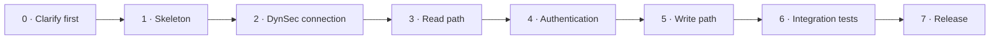

# PMSS – Implementation plan

**Project:** Phylax MQTT Security Service (PMSS)\
**Repository:** [`Noschvie/phylax-mqtt-security-service`](https://github.com/Noschvie/phylax-mqtt-security-service)\
**As of:** 25 November 2026\
**Based on:** [`phylax-mqtt-security-service-design`](phylax-mqtt-security-service-design.md), [`mqtt-security-service-api-v1`](mqtt-security-service-api-v1.md)

> **Guideline**
> Read path end to end first, then the write path. Every step is a pull request of its own.

## Flow

| Step | Content | Status | Pull request |
|---|---|---|---|
| 0 | Clarify first | ✅ | – (worked into the documents) |
| 1 | Skeleton | ✅ | [#2](https://github.com/Noschvie/phylax-mqtt-security-service/pull/2) |
| 2 | DynSec connection | ✅ | [#3](https://github.com/Noschvie/phylax-mqtt-security-service/pull/3) |
| 3 | Read path | ✅ | [#4](https://github.com/Noschvie/phylax-mqtt-security-service/pull/4) |
| 4 | Authentication | ✅ | [#5](https://github.com/Noschvie/phylax-mqtt-security-service/pull/5) |
| 5 | Write path | ✅ | [#6](https://github.com/Noschvie/phylax-mqtt-security-service/pull/6), extras [#7](https://github.com/Noschvie/phylax-mqtt-security-service/pull/7) |
| 6 | Integration tests | ✅ | [#8](https://github.com/Noschvie/phylax-mqtt-security-service/pull/8) |
| 7 | Release & operation | ✅ release, ⏳ operation | [#9](https://github.com/Noschvie/phylax-mqtt-security-service/pull/9), tag `v0.1.0` |

## Steps

### 0 · Clarify first ✅

- [x] `correlationData` in Mosquitto 2.1.2
- [x] `getClient` without password hash (S-5)
- [x] `autopaho` reconnect with open requests
- [x] JWT library chosen (`coreos/go-oidc/v3`, T-7)

The results are worked into the design and the specification.

### 1 · Skeleton ✅

- [x] `go.mod`, `cmd/`, `internal/`, SPDX header in every source file
- [x] Configuration by environment variables, `log/slog`, `/healthz`
- [x] Dockerfile `debian:trixie-slim`, non-root
- [x] CI: `go vet`, `go test -race`

### 2 · DynSec connection ✅

- [x] mTLS: server CA, admin certificate
- [x] `autopaho`, subscription of the response topic in `OnConnectionUp` (A-9)
- [x] Typed commands, correlation, timeouts
- [x] `broker_unavailable` / `broker_timeout` / `broker_error`

### 3 · Read path ✅

- [x] Model, sorting, ETag (S-4)
- [x] `GET` `info`, `export`, `clients`, `groups`, `roles`
- [x] `problem+json` with fixed codes
- [x] **Milestone:** first export end to end

### 4 · Authentication ✅

- [x] JWKS, `iss`, `aud`, `exp`/`nbf`, algorithm
- [x] Scopes `read` / `write`
- [x] `WWW-Authenticate`
- [x] Unit tests with an `httptest` issuer

### 5 · Write path ✅

- [x] Validation: names, prefix, password, ACL
- [x] `If-Match` → `412` / `428`
- [x] Clients, password, assignments, roles, `PUT …/acls`
- [x] Compensation, read-back, audit
- [x] PMSS extras: `PATCH` of the textname, `enable`/`disable`, single ACLs

### 6 · Integration tests ✅

- [x] One compose environment: Keycloak + Mosquitto/DynSec + service
- [x] Certificates generated per run
- [x] Test cases from design 7.9 and the specification, whole path token → REST → MQTT/mTLS → DynSec

### 7 · Release & operation

- [x] GitHub Actions → `ghcr.io` (`edge`, `vX.Y.Z`), tests before the push
- [ ] Migration phase 6: compose integration, NPM
- [ ] Keycloak configuration as code

## Alongside

> **Migration phases 1–3**
> Listener 8884 and DynSec are needed only for production. Development and tests run against the test broker (`test/integration/broker`, based on `mqtt-acl-verify`).

> **Decided: `disable` for `CN=` clients**
> ✅ Variant A: `enable`/`disable` for certificate clients are refused with `409 certificate_client`; locking is done with `DELETE` (specification, open point 8).

> **Decided: specification as an OpenAPI document**
> ✅ S-14: `api/openapi.yaml` (OpenAPI 3.2.1) in the repository; the Markdown specification stays normative. CI checks routes and recorded responses against the document (`test/openapi/check.py`, PR [#10](https://github.com/Noschvie/phylax-mqtt-security-service/pull/10), [#12](https://github.com/Noschvie/phylax-mqtt-security-service/pull/12)).
