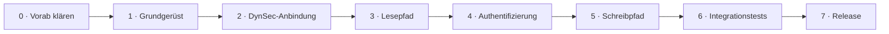

# PMSS – Implementierungsplan

**Projekt:** Phylax MQTT Security Service (PMSS)\
**Repository:** [`Noschvie/phylax-mqtt-security-service`](https://github.com/Noschvie/phylax-mqtt-security-service)\
**Stand:** 25. November 2026\
**Grundlage:** [`phylax-mqtt-security-service-design.de.md`](phylax-mqtt-security-service-design.de.md), [`mqtt-security-service-api-v1.de.md`](mqtt-security-service-api-v1.de.md)

> **Leitlinie**
> Erst den Lesepfad durchgehend, dann den Schreibpfad. Jeder Schritt ist ein eigener Pull Request.

## Ablauf

| Schritt | Inhalt | Status | Pull Request |
|---|---|---|---|
| 0 | Vorab klären | ✅ | – (in die Docs eingearbeitet) |
| 1 | Grundgerüst | ✅ | [#2](https://github.com/Noschvie/phylax-mqtt-security-service/pull/2) |
| 2 | DynSec-Anbindung | ✅ | [#3](https://github.com/Noschvie/phylax-mqtt-security-service/pull/3) |
| 3 | Lesepfad | ✅ | [#4](https://github.com/Noschvie/phylax-mqtt-security-service/pull/4) |
| 4 | Authentifizierung | ✅ | [#5](https://github.com/Noschvie/phylax-mqtt-security-service/pull/5) |
| 5 | Schreibpfad | ✅ | [#6](https://github.com/Noschvie/phylax-mqtt-security-service/pull/6), Extras [#7](https://github.com/Noschvie/phylax-mqtt-security-service/pull/7) |
| 6 | Integrationstests | ✅ | [#8](https://github.com/Noschvie/phylax-mqtt-security-service/pull/8) |
| 7 | Release & Betrieb | ✅ Release, ⏳ Betrieb | [#9](https://github.com/Noschvie/phylax-mqtt-security-service/pull/9), Tag `v0.1.0` |

## Schritte

### 0 · Vorab klären ✅

- [x] `correlationData` in Mosquitto 2.1.2
- [x] `getClient` ohne Passwort-Hash (S-5)
- [x] `autopaho`-Reconnect mit offenen Anfragen
- [x] JWT-Bibliothek gewählt (`coreos/go-oidc/v3`, T-7)

Ergebnisse sind in Design und Spezifikation eingearbeitet.

### 1 · Grundgerüst ✅

- [x] `go.mod`, `cmd/`, `internal/`, SPDX-Kopf in jeder Quelldatei
- [x] Konfiguration per Umgebungsvariablen, `log/slog`, `/healthz`
- [x] Dockerfile `debian:trixie-slim`, Nicht-Root
- [x] CI: `go vet`, `go test -race`

### 2 · DynSec-Anbindung ✅

- [x] mTLS: Server-CA, Admin-Zertifikat
- [x] `autopaho`, Abonnement des Response-Topics in `OnConnectionUp` (A-9)
- [x] Typisierte Kommandos, Korrelation, Timeouts
- [x] `broker_unavailable` / `broker_timeout` / `broker_error`

### 3 · Lesepfad ✅

- [x] Modell, Sortierung, ETag (S-4)
- [x] `GET` `info`, `export`, `clients`, `groups`, `roles`
- [x] `problem+json` mit festen Codes
- [x] **Meilenstein:** erster Export durchgehend

### 4 · Authentifizierung ✅

- [x] JWKS, `iss`, `aud`, `exp`/`nbf`, Algorithmus
- [x] Scopes `read` / `write`
- [x] `WWW-Authenticate`
- [x] Unit-Tests mit `httptest`-Aussteller

### 5 · Schreibpfad ✅

- [x] Validierung: Namen, Präfix, Passwort, ACL
- [x] `If-Match` → `412` / `428`
- [x] Clients, Passwort, Zuordnungen, Rollen, `PUT …/acls`
- [x] Ausgleichsweg, Zurücklesen, Audit
- [x] PMSS-Extras: `PATCH` des Textnamens, `enable`/`disable`, einzelne ACLs

### 6 · Integrationstests ✅

- [x] Eine Compose-Umgebung: Keycloak + Mosquitto/DynSec + Service
- [x] Zertifikate pro Lauf erzeugen
- [x] Testfälle aus Design 7.9 und der Spezifikation, Gesamtweg Token → REST → MQTT/mTLS → DynSec

### 7 · Release & Betrieb

- [x] GitHub Actions → `ghcr.io` (`edge`, `vX.Y.Z`), Tests vor dem Push
- [ ] Migrationsphase 6: Compose-Einbindung, NPM
- [ ] Keycloak als Config-as-Code

## Läuft mit

> **Migration Phase 1–3**
> Listener 8884 und DynSec sind erst für die Produktion nötig. Entwickelt und getestet wird gegen den Test-Broker (`test/integration/broker`, Vorlage aus `mqtt-acl-verify`).

> **Entschieden: `disable` für `CN=`-Clients**
> ✅ Variante A: `enable`/`disable` für Zertifikats-Clients werden mit `409 certificate_client` abgelehnt; gesperrt wird mit `DELETE` (Spezifikation, offener Punkt 8).

> **Entschieden: Spezifikation als OpenAPI-Datei**
> ✅ S-14: `api/openapi.yaml` (OpenAPI 3.2.1) im Repository; maßgeblich bleibt die Markdown-Spezifikation. CI prüft Routen und aufgezeichnete Antworten gegen die Datei (`test/openapi/check.py`, PR [#10](https://github.com/Noschvie/phylax-mqtt-security-service/pull/10), [#12](https://github.com/Noschvie/phylax-mqtt-security-service/pull/12)).
